<div align="center">

# Plataforma de Cobrança Automatizada

**Importa carteiras de devedores, aplica uma régua de cobrança configurável e dispara mensagens<br/>por e-mail, SMS e WhatsApp, com reenvios, auditoria e conformidade com a LGPD.**

<a href="https://cobranca-tcc.duckdns.org"></a>
<a href="./docs/RFC.md"></a>
<a href="#documentação"></a>

<a href="https://github.com/MarieleV/PlataformaCobranca/actions/workflows/ci.yml"></a>
<a href="https://sonarcloud.io/summary/new_code?id=MarieleV_PlataformaCobranca"></a>
<a href="https://sonarcloud.io/summary/new_code?id=MarieleV_PlataformaCobranca"></a>


<sub>Trabalho de Conclusão de Curso · Engenharia de Software · Católica SC · em parceria com a Consulth Soluções</sub>

<br/>

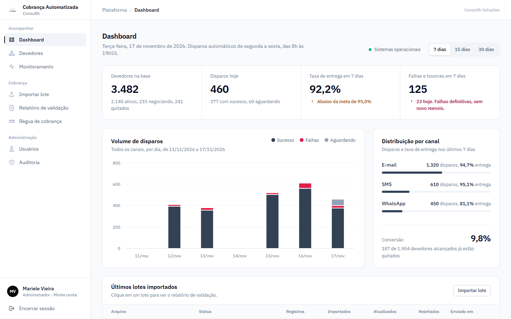

</div>

---

## Visão geral

Empresas que cobram a própria carteira de inadimplentes costumam fazer isso com planilhas e e-mails enviados um a um: o processo é lento, cada analista aplica uma régua diferente e ninguém sabe ao certo quem recebeu o quê. Na empresa parceira, **100% dos entrevistados** relataram envio manual e **80%** disseram não ter rastreabilidade das comunicações.

Esta plataforma automatiza o ciclo inteiro, como um produto SaaS B2B:

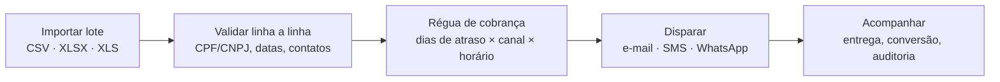

| | |
|---|---|
| **Em produção** | AWS (EC2 + RDS), HTTPS e deploy contínuo com aprovação manual |
| **41 endpoints REST** | FastAPI com OpenAPI, RBAC em 3 perfis e auditoria de ações sensíveis |
| **789 testes no back-end** | ~97% de cobertura (pytest); mínimo de 80% exigido no CI |
| **72 testes no front-end** | ~91% de cobertura na lógica (Vitest); lint e tipos sem avisos |
| **5 checks obrigatórios** | Nenhum código chega à `main` sem testes, migrações, build e Quality Gate aprovados |

---

## Telas

<table>
  <tr>
    <td width="50%">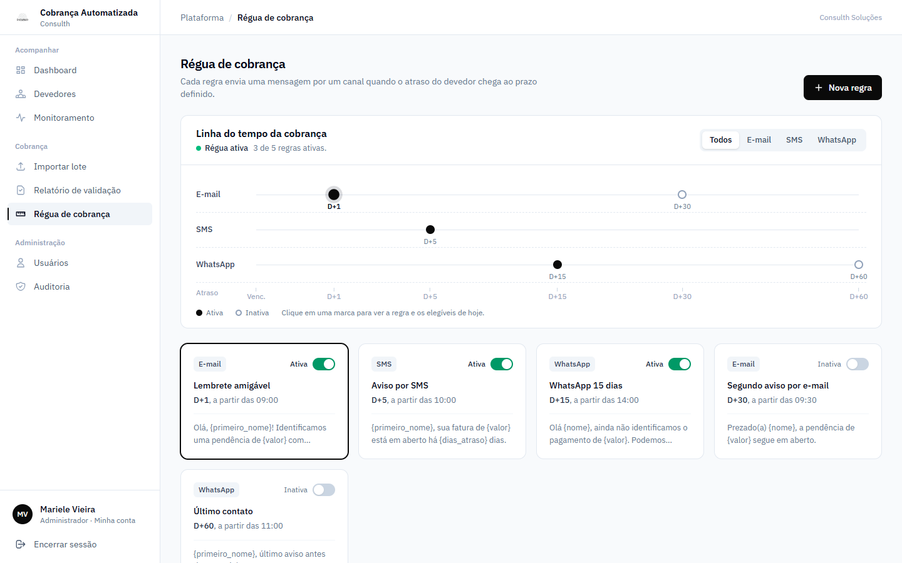</td>
    <td width="50%">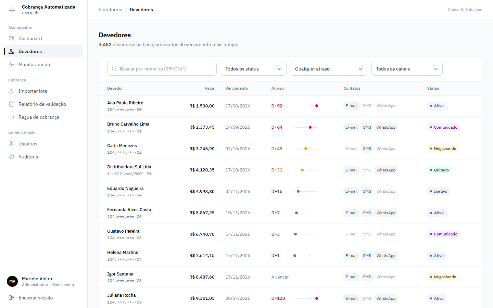</td>
  </tr>
  <tr>
    <td><sub><b>Régua de cobrança.</b> Cada regra aparece no seu dia de atraso (D+N), por canal; a marca cheia indica regra ativa.</sub></td>
    <td><sub><b>Devedores.</b> Busca por nome ou CPF/CNPJ, filtros por status, atraso e canal; CPF mascarado (LGPD).</sub></td>
  </tr>
  <tr>
    <td width="50%">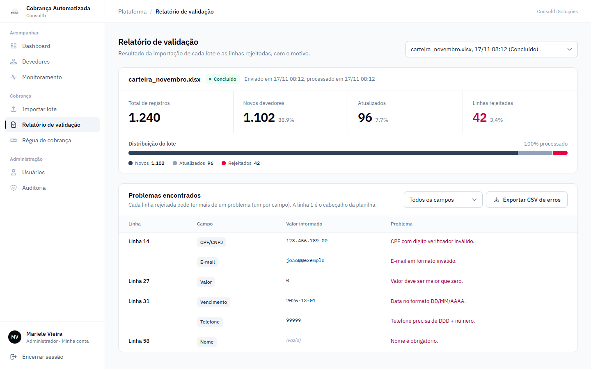</td>
    <td width="50%">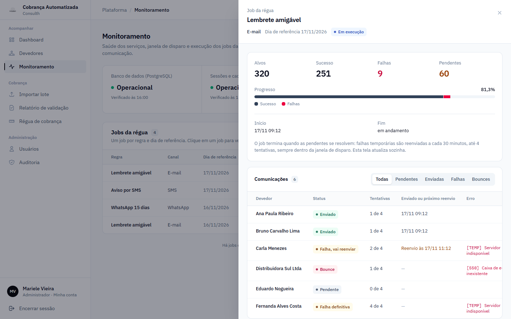</td>
  </tr>
  <tr>
    <td><sub><b>Relatório de validação.</b> Totais do lote e cada linha rejeitada com o campo e a regra violada; exporta CSV.</sub></td>
    <td><sub><b>Monitoramento.</b> Resultado de cada comunicação do job: enviada, reenvio agendado, bounce ou falha definitiva.</sub></td>
  </tr>
</table>

<details>
<summary><b>Mais telas</b> (login e versão para celular)</summary>
<br/>
<p align="center">
  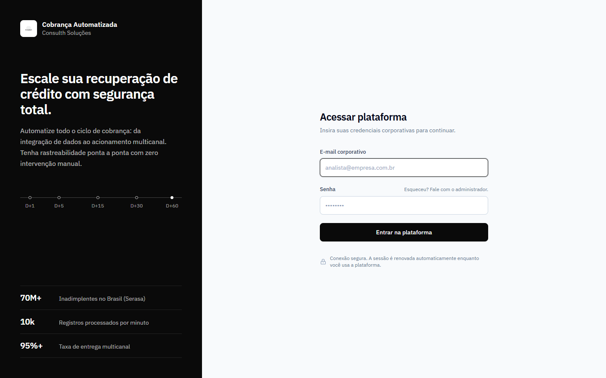
  &nbsp;
  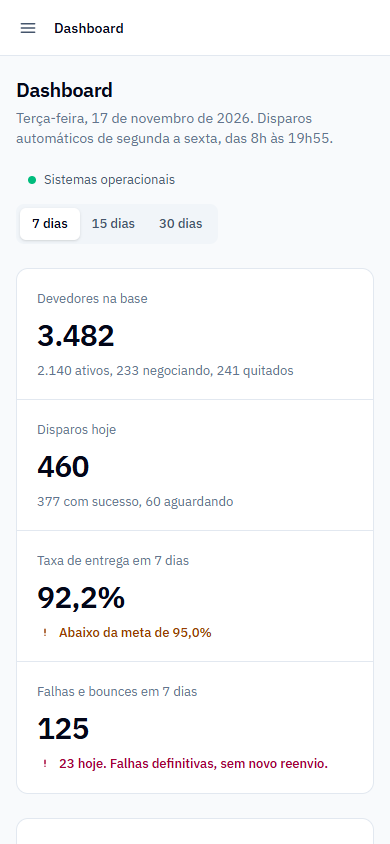
</p>
</details>

> [!NOTE]
> As capturas usam dados fictícios. O ambiente de produção exige login; o envio real de mensagens fica desligado (modo simulado) até a validação dos provedores.

---

## Arquitetura

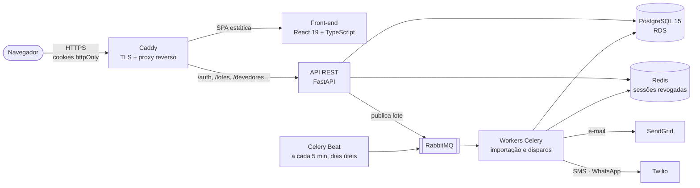

1. **Ingestão.** O upload devolve na hora; o lote vai para a fila e o front acompanha o progresso por *polling*.
2. **Validação.** O worker lê a planilha com pandas em blocos de 1.000 linhas, valida cada uma (CPF/CNPJ com dígito verificador, datas, valores, e-mail, telefone) e grava os erros por linha. Reimportar um CPF/CNPJ existente **atualiza** o cadastro.
3. **Régua.** A cada 5 minutos, em dias úteis e fora de feriados, o Beat cria os jobs das regras ativas com os devedores elegíveis do dia.
4. **Disparo.** O worker interpola o template com os dados do devedor e envia pelo provedor do canal; falhas temporárias entram em reenvio.
5. **Acompanhamento.** Dashboard, monitoramento de jobs, histórico por devedor, auditoria e métricas Prometheus.

<details>
<summary><b>Sequência da importação de um lote</b></summary>
<br/>

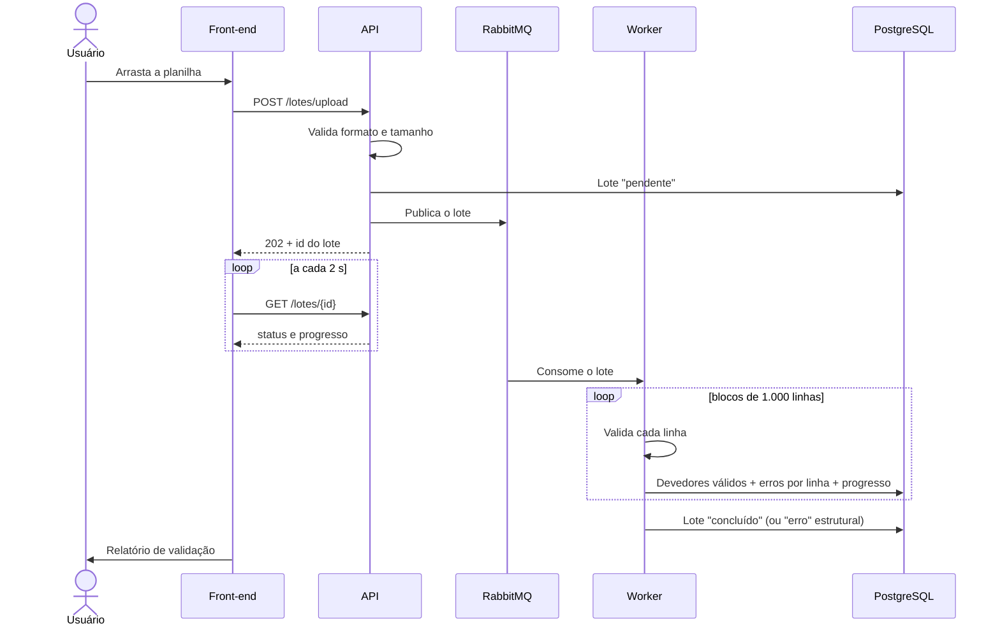

</details>

---

## Decisões técnicas

As escolhas abaixo são as que mais influenciaram o sistema. Cada uma tem uma alternativa mais simples que foi descartada de propósito.

<details open>
<summary><b>Sessão em cookies <code>httpOnly</code>, não em <code>localStorage</code></b></summary>

- **Decisão:** o back-end grava o *access token* (15 min) e o *refresh token* (7 dias, com rotação) em cookies `httpOnly`; o JavaScript nunca vê o token. Em 401, o front faz **um único** refresh compartilhado entre as requisições simultâneas.
- **Por quê:** um token em `localStorage` é legível por qualquer script injetado (XSS). O logout e a troca de senha revogam as sessões no Redis, o que um JWT puro não permitiria.
- **Consequência assumida:** o cookie de refresh tem `path=/auth`; por isso a API é servida **no mesmo domínio e sem prefixo** (`/auth`, não `/api/auth`). Um prefixo faria o navegador deixar de enviar o cookie.

</details>

<details>
<summary><b>Fila e workers em vez de processamento na requisição</b></summary>

- **Decisão:** upload e disparos rodam em workers Celery via RabbitMQ, com `acks_late` e `prefetch=1`.
- **Por quê:** um lote de 50.000 linhas não pode prender uma requisição HTTP. Com `acks_late`, se um worker cair no meio do lote, a mensagem volta para a fila; com `prefetch=1`, lotes longos não ficam "reservados" para um worker ocupado.

</details>

<details>
<summary><b>Disparo idempotente e seguro para vários workers</b></summary>

- **Decisão:** a criação do job trava a regra (`SELECT … FOR UPDATE`) e o banco tem restrição única por regra e dia; cada comunicação é reservada com `FOR UPDATE SKIP LOCKED`.
- **Por quê:** com vários workers e o agendador rodando a cada 5 minutos, a mesma mensagem não pode sair duas vezes para o mesmo devedor. A regra de negócio "no máximo uma comunicação bem-sucedida por canal por dia" é garantida no banco, não só no código.

</details>

<details>
<summary><b>Criptografia do valor da dívida na aplicação</b></summary>

- **Decisão:** o valor é cifrado com Fernet antes de ir ao banco, além da criptografia do disco/RDS.
- **Por quê:** quem tiver acesso ao banco (backup, *dump*, consulta direta) não lê valores financeiros.
- **Consequência assumida:** não há somas em R$ no dashboard, porque o SQL não enxerga os valores. Os indicadores usam contagens e taxas.

</details>

<details>
<summary><b>Banco gerenciado, fila e cache em contêiner</b></summary>

- **Decisão:** em produção, PostgreSQL no RDS (backup, criptografia, sem acesso público) e RabbitMQ/Redis em contêiner na EC2.
- **Por quê:** o banco guarda o que não pode ser perdido; fila e cache guardam dados transitórios. Os equivalentes gerenciados (Amazon MQ, ElastiCache) multiplicariam o custo sem ganho proporcional.
- **Região:** `us-east-2` (Ohio) por custo; o trade-off de latência e LGPD está justificado em [`docs/DEPLOY.md`](./docs/DEPLOY.md#4-escolha-da-região-us-east-2-ohio).

</details>

<details>
<summary><b>Interface: cor só para estado</b></summary>

- **Decisão:** a interface é preto, branco e cinza; a cor aparece só para dizer algo sobre a cobrança (atraso, entrega, falha, quitação). Nos gráficos, sucesso é grafite e falha é vermelho.
- **Por quê:** quem bate o olho vê primeiro o que precisa de atenção. Verde × vermelho empilhados é indistinguível para daltonismo (deuteranopia); a paleta foi verificada com um validador de contraste e de visão de cores.

</details>

---

## Funcionalidades

| Módulo | O que faz |
|---|---|
| **Importação de lotes** | CSV, XLSX e XLS até 50.000 linhas e 20 MB; progresso em tempo real; relatório de erros por linha com download em CSV; reimportação atualiza devedores |
| **Devedores** | Busca por nome ou CPF/CNPJ; filtros por status, atraso e canal; histórico de comunicações; troca de status; exclusão a pedido do titular (LGPD) |
| **Régua de cobrança** | Regras por canal, dias de atraso, horário e template com variáveis (`{primeiro_nome}`, `{valor}`, `{dias_atraso}`…); pré-visualização; elegíveis do dia; execução manual |
| **Disparos** | E-mail (SendGrid), SMS e WhatsApp (Twilio); até 4 tentativas a cada 30 min; *bounce* encerra as tentativas; modo simulado para desenvolvimento |
| **Dashboard** | Devedores na base, disparos do dia, taxa de entrega × meta de 95%, falhas, conversão, volume diário e distribuição por canal |
| **Monitoramento** | Saúde dos serviços, janela de disparo, jobs e o resultado de cada comunicação |
| **Usuários e auditoria** | Três perfis (administrador, gestor, operador); gestor administra só operadores; trilha de auditoria filtrável |

<details>
<summary><b>Principais regras de negócio</b></summary>
<br/>

| Regra | Como funciona |
|---|---|
| Elegibilidade | Atraso **exatamente** igual ao da regra, devedor `ativo` ou `comunicado` e contato para o canal |
| Janela de disparo | Segunda a sexta, 8h às 19h55 (Brasília), exceto feriados nacionais e configurados |
| Limite diário | No máximo uma comunicação bem-sucedida por devedor, canal e dia |
| Reenvio | 1 envio + até 3 reenvios, a cada 30 minutos; e-mail/telefone inválido é falha definitiva |
| Régua | Toda regra nasce inativa; só uma regra ativa por canal e dia de atraso |
| Quitação | Só gestor e administrador marcam `quitado`; devedor quitado não é reaberto nem reimportado |

A especificação completa está no [RFC](./docs/RFC.md).
</details>

---

## Qualidade e entrega contínua

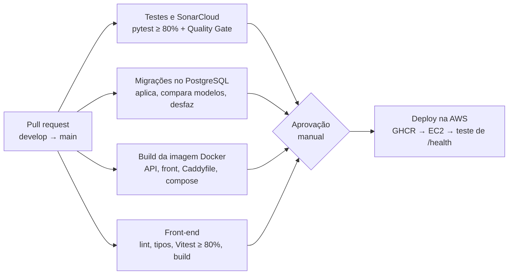

- **`main` protegida por Ruleset:** só recebe código por pull request, com os quatro checks aprovados.
- **Deploy sem acesso manual ao servidor:** o pipeline publica as imagens no GitHub Container Registry (tag = commit), atualiza os contêineres na EC2 por SSH, espera todos ficarem saudáveis e testa o domínio público. Voltar uma versão é subir a tag de um commit anterior.
- **Migrações testadas de verdade:** o CI aplica as migrações num PostgreSQL 15 real, confere se os modelos e o esquema estão em sincronia e testa desfazer/refazer a última.
- **Fluxo de trabalho:** git-flow (`feature/*` → `develop` → PR para `main`) e [Conventional Commits](https://www.conventionalcommits.org/pt-br/).
- **Desempenho medido:** teste de carga com k6 em [`carga/`](./carga/README.md), com os limites do RFC como critério automático. Com 100 usuários simultâneos, o P95 ficou em 75–99 ms (limite de 300 ms) e não houve falhas, mesmo num notebook de entrada. O teste também revelou duas correções de código.

---

## Segurança e LGPD

| Camada | Controle |
|---|---|
| Sessão | Cookies `httpOnly` + `Secure` + `SameSite=Lax`; refresh com rotação; revogação no logout, na troca de senha e na desativação |
| Senhas | bcrypt (custo 12); 8 a 128 caracteres com letra e número; bloqueio após 5 tentativas (HTTP 429) |
| Autorização | RBAC verificado em cada rota da API e refletido na interface |
| Dados | Valor da dívida cifrado (Fernet); CPF/CNPJ mascarado nas listas; exclusão a pedido do titular (LGPD, art. 18) registrada na auditoria |
| Transporte | HTTPS com HSTS; conexão TLS obrigatória com o banco; a API se recusa a subir em produção sem `COOKIE_SECURE` e `sslmode=require` |
| Rede | Banco sem acesso público; só o proxy fica exposto; `/docs` e `/metrics` não são publicados |

---

## Stack

| Camada | Tecnologias |
|---|---|
| **Front-end** |      |
| **Back-end** |      |
| **Dados e mensageria** |     |
| **Infraestrutura** |     |
| **Qualidade e observabilidade** |       |
| **Integrações** |   |

---

## Como executar

**Pré-requisitos:** Docker Desktop, Node.js 22 LTS e Git.

```bash
git clone https://github.com/MarieleV/PlataformaCobranca.git
cd PlataformaCobranca/back-end
cp .env.example .env                       # PowerShell: Copy-Item .env.example .env
docker compose up -d --build               # API, worker, beat, PostgreSQL, Redis e RabbitMQ
docker exec -it cobranca_api python -m app.seed

cd ../front-end
cp .env.example .env
npm install
npm run dev
```

| Serviço | Endereço |
|---|---|
| Aplicação | <http://localhost:8443> · `admin@consulth.com.br` / `admin123` (só local) |
| API e documentação interativa | <http://localhost:8000/docs> |
| Saúde dos serviços | <http://localhost:8000/health> |

> [!TIP]
> O envio real vem **desligado** (`ENVIO_SIMULADO=true`). O simulador responde conforme o contato: e-mail começando com `bounce` ou telefone terminando em `0000` gera *bounce*; e-mail começando com `falha` ou telefone terminando em `9999` gera falha temporária (e reenvio). Dá para ver o fluxo completo sem custo com provedores.

<details>
<summary><b>Testes, validação e monitoramento</b></summary>
<br/>

```bash
# Back-end (pasta back-end, com o ambiente virtual ativo)
pip install -r requirements-dev.txt
pytest --cov=app

# Front-end (pasta front-end): lint, tipos, testes com cobertura e build, igual ao CI
npm run verificar

# Prometheus (:9090) e Grafana (:3000), opcional
docker compose -f docker-compose.yml -f docker-compose.monitoring.yml up -d
```

Detalhes em [`back-end/DOC.md`](./back-end/DOC.md) e [`front-end/README.md`](./front-end/README.md).
</details>

---

## Estrutura do repositório

```text
PlataformaCobranca/
├── back-end/          API FastAPI, workers Celery, migrações Alembic e testes (pytest)
├── front-end/         SPA React + TypeScript, testes (Vitest) e imagem Docker com Caddy
├── deploy/            Compose de produção, preparação da EC2 e guia da AWS
├── carga/             Teste de carga (k6) e gerador de massa de dados
├── docs/              RFC (requisitos), registro do deploy e imagens
└── .github/workflows/ Pipeline de CI/CD
```

---

## Documentação

| Documento | Conteúdo |
|---|---|
| [**RFC**](./docs/RFC.md) | Problema, personas, requisitos funcionais e não funcionais, regras de negócio, arquitetura (C4) e modelo de dados |
| [**Back-end**](./back-end/DOC.md) | Execução, configuração, testes, CI/CD, métricas, regras e limitações conhecidas |
| [**Front-end**](./front-end/README.md) | Arquitetura da SPA, integração com a API, sistema visual e testes |
| [**Deploy (guia operacional)**](./deploy/README.md) | Passo a passo da AWS (EC2 + RDS), segredos e operação |
| [**Deploy (registro para o TCC)**](./docs/DEPLOY.md) | Decisões de produção, justificativa da região, segurança e rastreabilidade com o RFC |
| [**Teste de carga**](./carga/README.md) | RNF01/RNF02 com k6 e lote de 50.000 registros (RNF03) |
| [**Roteiro de testes**](./front-end/ROTEIRO_TESTES.md) | Testes manuais de todas as telas |

---

## Roadmap

- [x] Importação e validação assíncrona de lotes
- [x] Régua de cobrança com agendamento, feriados e reenvios
- [x] Autenticação, RBAC, auditoria e LGPD
- [x] Dashboard, monitoramento e métricas Prometheus
- [x] CI/CD com Quality Gate e deploy na AWS
- [x] Filtro de devedores por canal de contato (RF05)
- [x] Requisitos de desempenho comprovados com teste de carga: 100 usuários com P95 de 75–99 ms e 0% de falhas; lote de 50.000 registros em 116 s ([resultados](./carga/README.md#resultados))
- [ ] Validação com os provedores reais (SendGrid e Twilio)
- [ ] Webhooks de confirmação de entrega (`entregue`)
- [ ] Templates aprovados do WhatsApp Business

---

<div align="center">

**Mariele Vieira da Silva**<br/>
<sub>Engenharia de Software · Católica SC</sub>

<a href="https://www.linkedin.com/in/mariele-vieira"></a>
<a href="https://github.com/MarieleV"></a>
<a href="mailto:silvamariele797@gmail.com"></a>

</div>
