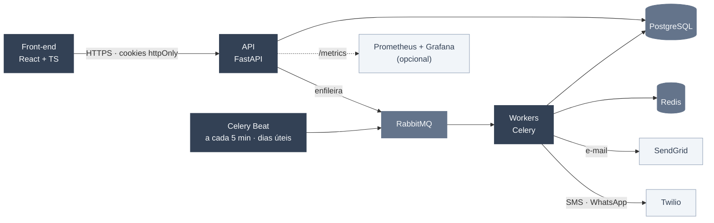

<h1 align="center">
  
</h1>

<p align="center">
  SaaS B2B de cobrança automatizada: importação em lote, régua de cobrança e disparo por e-mail, SMS e WhatsApp.<br/>
  Trabalho de Conclusão de Curso · Engenharia de Software · Católica SC · em parceria com a <strong>Consulth</strong>
</p>

<p align="center">
  <a href="./docs/RFC.md">
    
  </a>
  <a href="./back-end/DOC.md">
    
  </a>
  <a href="https://www.figma.com/design/aTgE91sZyzbxTrB8kh5clh/Plataforma-de-Cobran%C3%A7a-Automatizada" target="_blank">
    
  </a>
</p>

<p align="center">
  
  
  
  
  
  
  
  
  
  
</p>
<p align="center">
  
  
  
  
</p>

---

<p align="center">
  <a href="#-sobre-o-projeto">Sobre</a> ·
  <a href="#-destaques-técnicos">Destaques</a> ·
  <a href="#-arquitetura">Arquitetura</a> ·
  <a href="#-funcionalidades">Funcionalidades</a> ·
  <a href="#-regras-de-negócio">Regras de Negócio</a> ·
  <a href="#-tech-stack">Stack</a>
  <br/>
  <a href="#-segurança-e-lgpd">Segurança e LGPD</a> ·
  <a href="#-qualidade-e-cicd">Qualidade e CI/CD</a> ·
  <a href="#-como-executar">Como Executar</a> ·
  <a href="#-status-do-projeto">Status</a> ·
  <a href="#-design-system">Design System</a> ·
  <a href="#-documentação">Documentação</a>
</p>

---

##  → Sobre o Projeto

Empresas B2B que operam carteiras de cobrança ainda dependem, em boa parte, de planilhas soltas e disparos manuais para tratar a inadimplência. O processo é lento, sujeito a erro humano e não escala.

A **Plataforma de Cobrança Automatizada** resolve isso com um pipeline auditável de ponta a ponta:

1. **Importa** lotes de devedores (CSV, XLSX, XLS) e valida cada linha;
2. **Aplica** uma régua de cobrança configurável (dias de atraso × canal × horário × template);
3. **Dispara** mensagens por **e-mail (SendGrid)**, **SMS** e **WhatsApp (Twilio)**, com reenvios automáticos;
4. **Acompanha** tudo em um dashboard com taxas de entrega e conversão.

O projeto foi construído como um produto SaaS de verdade: arquitetura orientada a filas, controle de acesso por perfil, trilha de auditoria, conformidade com a LGPD, testes automatizados e pipeline de CI com Quality Gate.

<br/>

##  → Destaques Técnicos

- **Processamento assíncrono** — importação e disparos rodam em workers Celery via RabbitMQ; a API responde na hora e o front acompanha o progresso por polling.
- **Agendamento com regras de negócio** — o Celery Beat avalia a régua a cada 5 minutos, apenas em dias úteis e dentro da janela comercial (08h–19h, horário de Brasília).
- **Resiliência no envio** — até 4 tentativas com intervalo de 30 min; contatos inválidos são marcados como `bounce` e não são reenviados.
- **Autenticação segura** — tokens em **cookies httpOnly** (o JavaScript nunca vê o token), com refresh rotativo, bloqueio por excesso de tentativas (HTTP 429) e CORS restrito por origem.
- **RBAC + auditoria** — três perfis (administrador, gestor, operador) aplicados na API e refletidos na interface; ações sensíveis ficam registradas.
- **LGPD por design** — valor da dívida criptografado no banco, exclusão de titular sob demanda e cuidado para não expor CPF/CNPJ em logs.
- **Qualidade garantida no merge** — `main` protegida por Ruleset: exige PR e aprovação dos checks de testes, SonarCloud, migrações em PostgreSQL, build Docker e front-end.

<br/>

##  → Arquitetura



**Fluxo de dados**

1. **Ingestão** — o usuário envia a planilha pelo portal (`POST /lotes/upload`).
2. **Mensageria** — o lote é enfileirado no RabbitMQ, sem bloquear a API.
3. **Processamento** — workers validam linha a linha (CPF/CNPJ, valores, datas, contatos) e gravam no PostgreSQL. Reimportar um CPF/CNPJ existente **atualiza** o cadastro.
4. **Orquestração** — o Celery Beat identifica os devedores elegíveis para cada regra ativa da régua.
5. **Disparo** — as mensagens são interpoladas com os dados do devedor e enviadas pelos provedores; falhas temporárias entram na fila de reenvio.
6. **Acompanhamento** — jobs, comunicações e indicadores ficam disponíveis no dashboard e no console de monitoramento.

<br/>

##  → Funcionalidades

<table align="center" width="100%">
  <tr>
    <td width="50%" valign="top">
      <h3>Autenticação e sessão</h3>
      <ul>
        <li>Sessão em cookies httpOnly, com renovação automática do token (refresh em caso de 401) e logout.</li>
        <li>Rotas protegidas por perfil e troca da própria senha.</li>
      </ul>
    </td>
    <td width="50%" valign="top">
      <h3>Dashboard</h3>
      <ul>
        <li>KPIs: devedores na base, disparos, taxa de entrega (meta de 95%), taxa de conversão e falhas.</li>
        <li>Linha do tempo de 7 dias, distribuição por canal e últimos lotes.</li>
        <li>Indicadores sem base de cálculo aparecem como "—" em vez de valores enganosos.</li>
      </ul>
    </td>
  </tr>
  <tr>
    <td width="50%" valign="top">
      <h3>Importação de lotes</h3>
      <ul>
        <li>Upload de CSV, XLSX e XLS com progresso em tempo real.</li>
        <li>Relatório de validação por linha, com a regra violada, e download do CSV de erros.</li>
        <li>Contadores de registros importados, atualizados e rejeitados.</li>
      </ul>
    </td>
    <td width="50%" valign="top">
      <h3>Devedores</h3>
      <ul>
        <li>Busca por nome ou CPF/CNPJ, filtros por status e atraso mínimo, e paginação.</li>
        <li>Detalhe com histórico completo de comunicações.</li>
        <li>Troca de status (<strong>quitado</strong> só para gestor/administrador) e exclusão LGPD (só administrador).</li>
      </ul>
    </td>
  </tr>
  <tr>
    <td width="50%" valign="top">
      <h3>Régua de cobrança</h3>
      <ul>
        <li>CRUD de regras por canal, dias de atraso, horário de disparo e template.</li>
        <li>Variáveis dinâmicas (<code>{nome}</code>, <code>{primeiro_nome}</code>, <code>{valor}</code>, <code>{data_vencimento}</code>, <code>{dias_atraso}</code>) com pré-visualização da mensagem.</li>
        <li>Ativação com tratamento de conflito, consulta de elegíveis e execução manual.</li>
      </ul>
    </td>
    <td width="50%" valign="top">
      <h3>Monitoramento</h3>
      <ul>
        <li>Jobs de disparo e comunicações geradas, com atualização por polling.</li>
        <li>Métricas em <code>/metrics</code> (Prometheus) e saúde dos serviços em <code>/health</code>.</li>
      </ul>
    </td>
  </tr>
  <tr>
    <td colspan="2" valign="top">
      <h3>Usuários e auditoria</h3>
      <ul>
        <li>CRUD de usuários, ativação/desativação e redefinição de senha. Gestores administram operadores; administradores administram todos.</li>
        <li>Trilha de auditoria filtrável por usuário, ação, entidade e período (só administrador).</li>
      </ul>
    </td>
  </tr>
</table>

<br/>

##  → Regras de Negócio

| Regra | Descrição |
|---|---|
| Janela de disparo | Seg–sex, 08h–19h (Brasília); horário de cada regra entre 08:00 e 20:00 |
| Elegibilidade | Atraso exatamente igual ao da regra, devedor `ativo` ou `comunicado` e contato válido para o canal |
| Limite diário | No máximo uma comunicação bem-sucedida por canal, por devedor, por dia |
| Reenvio | Até 4 tentativas, com 30 min de intervalo |
| Bounce | E-mail ou telefone inválido encerra as tentativas para aquele contato |
| Unicidade da régua | Uma regra ativa por combinação de canal e dias de atraso; toda regra nasce inativa |
| Limite de template | SMS 480 · WhatsApp 1.024 · e-mail 5.000 caracteres |
| Quitação | Devedor quitado não é reaberto nem reimportado |

**Status do devedor:** `ativo` · `comunicado` · `negociando` · `quitado` · `inativo`<br/>
**Status da comunicação:** `pendente` · `enviado` · `entregue` · `falha` · `bounce`

<br/>

##  → Tech Stack

<div align="center">
  <table align="center" cellspacing="10" cellpadding="10">
    <!-- Front-end -->
    <tr>
      <td align="center" width="16%">
        <br/>TypeScript
      </td>
      <td align="center" width="16%">
        <br/>React 19
      </td>
      <td align="center" width="16%">
        <br/>Vite 8
      </td>
      <td align="center" width="16%">
        <br/>Tailwind
      </td>
      <td align="center" width="16%">
        <br/>Vitest
      </td>
      <td align="center" width="16%">
        <br/>ESLint
      </td>
    </tr>
    <!-- Back-end & Dados -->
    <tr>
      <td align="center">
        <br/>Python 3.14
      </td>
      <td align="center">
        <br/>FastAPI
      </td>
      <td align="center">
        <br/>SQLAlchemy
      </td>
      <td align="center">
        <br/>Pandas
      </td>
      <td align="center">
        <br/>PostgreSQL
      </td>
      <td align="center">
        <br/>pytest
      </td>
    </tr>
    <!-- Mensageria, Infra & Observabilidade -->
    <tr>
      <td align="center">
        <br/>RabbitMQ
      </td>
      <td align="center">
        <br/>Celery
      </td>
      <td align="center">
        <br/>Redis
      </td>
      <td align="center">
        <br/>Docker
      </td>
      <td align="center">
        <br/>Prometheus
      </td>
      <td align="center">
        <br/>GitHub Actions
      </td>
    </tr>
  </table>
</div>

<details>
<summary><strong>Papel de cada tecnologia</strong></summary>
<br/>

**Front-end**

| Camada | Tecnologia | Papel |
|---|---|---|
| Build & Framework | React 19 + Vite 8 | SPA com HMR e bundle otimizado |
| Linguagem | TypeScript (strict) | Tipagem dos modelos e das respostas da API |
| Estilo | Tailwind CSS | Design system corporativo |
| Sessão | Context API + cookies httpOnly | Rotas protegidas e refresh automático |
| Qualidade | ESLint · `tsc --noEmit` · Vitest + Testing Library | Lint, checagem de tipos e testes |

**Back-end**

| Camada | Tecnologia | Papel |
|---|---|---|
| API | FastAPI (Python 3.14) | REST com documentação OpenAPI autogerada |
| ORM & Migrações | SQLAlchemy 2.1 + Alembic | Modelagem e versionamento do banco |
| Processamento | Pandas | Validação de lotes de importação |
| Filas & Agendamento | RabbitMQ + Celery (worker e beat) + Redis | Execução assíncrona e tarefas periódicas |
| Persistência | PostgreSQL 15 | Banco relacional principal |
| Provedores | SendGrid · Twilio | E-mail, SMS e WhatsApp |
| Observabilidade | Prometheus + Grafana | Métricas da aplicação (opcional) |
| Infraestrutura | Docker + Docker Compose | Ambiente reproduzível |

</details>

<br/>

##  → Segurança e LGPD

- Tokens de acesso (15 min) e refresh (7 dias, com rotação) em cookies httpOnly.
- Senhas de 8 a 128 caracteres, com ao menos uma letra e um número; bloqueio temporário após 5 tentativas de login malsucedidas.
- CORS restrito às origens configuradas, com credenciais habilitadas.
- Valor da dívida armazenado de forma criptografada.
- Exclusão de dados do titular (LGPD) restrita ao administrador e registrada na auditoria.

<br/>

##  → Qualidade e CI/CD

| Categoria | Ferramenta / Escopo | Situação |
|---|---|---|
| **CI** | GitHub Actions a cada PR e na `main` |  |
| **Testes (back-end)** | `pytest` — 783 testes, ~97% de cobertura (mínimo: 80%) |  |
| **Testes (front-end)** | Vitest + Testing Library (cliente da API e contexto de autenticação) |  |
| **Lint e tipos (front-end)** | ESLint + `tsc --noEmit` |  |
| **Migrações** | Alembic aplicado em PostgreSQL 15 real |  |
| **Build** | Imagem Docker |  |
| **Análise estática** | SonarCloud com Quality Gate (PRs e `main`) |  |
| **Deploy** | AWS (RDS + EC2) |  |

**Fluxo de trabalho:** git-flow (`feature/*` → `develop` → PR para `main`) e commits no padrão [Conventional Commits](https://www.conventionalcommits.org/pt-br/). A `main` é protegida e só recebe código via Pull Request com todos os checks aprovados.

<br/>

##  → Como Executar

**Pré-requisitos:** Docker e Docker Compose, Node.js (LTS) e Git.

### 1. Back-end

```bash
git clone https://github.com/MarieleV/PlataformaCobranca.git
cd PlataformaCobranca/back-end
cp .env.example .env              # no PowerShell: Copy-Item .env.example .env
docker compose up -d --build
```

As migrações são aplicadas automaticamente ao subir a API. Para criar o usuário administrador de desenvolvimento:

```bash
docker exec -it cobranca_api python -m app.seed
```

> Login de desenvolvimento: `admin@consulth.com.br` / `admin123` — **apenas para ambiente local.**

### 2. Front-end

```bash
cd ../front-end
npm install
npm run dev
```

| Serviço | Endereço |
|---|---|
| Front-end | http://localhost:5173 |
| API | http://localhost:8000 |
| Documentação interativa (Swagger) | http://localhost:8000/docs |
| Saúde dos serviços | http://localhost:8000/health |

### Modo de demonstração

Por padrão o envio real fica **desligado** (`ENVIO_SIMULADO=true`), então é possível explorar todo o fluxo sem custo com provedores. O simulador reage ao contato informado:

| Contato | Resultado simulado |
|---|---|
| E-mail iniciado por `bounce` ou telefone terminado em `0000` | `bounce` |
| E-mail iniciado por `falha` ou telefone terminado em `9999` | Falha temporária (entra em reenvio) |
| Qualquer outro | `enviado` |

### Testes

```bash
# Back-end (com o ambiente virtual ativado)
cd back-end
pip install -r requirements-dev.txt
pytest

# Front-end
cd front-end
npm run lint
npx tsc --noEmit
npm test
```

### Monitoramento (opcional)

```bash
cd back-end
docker compose -f docker-compose.yml -f docker-compose.monitoring.yml up -d
```

Prometheus em http://localhost:9090 e Grafana em http://localhost:3000.

<br/>

##  → Status do Projeto

| Módulo | Status |
|---|---|
| Autenticação, sessão e RBAC |  |
| Importação e validação de lotes |  |
| Gestão de devedores (incl. LGPD) |  |
| Régua de cobrança (motor de regras) |  |
| Disparo multicanal com reenvios (modo simulado por padrão) |  |
| Dashboard e indicadores |  |
| Console de monitoramento (dados reais da API) |  |
| Usuários e auditoria |  |
| CI/CD com Quality Gate |  |
| Validação com provedores reais (SendGrid/Twilio) |  |
| Deploy em nuvem (AWS) |  |
| Webhooks de confirmação de entrega |  |
| Templates aprovados do WhatsApp (produção) |  |

<br/>

##  → Design System

A interface segue um padrão **SaaS corporativo**, inspirado em ferramentas como Vercel e Stripe.

- **UI limpa e monocromática** — paleta em tons de slate (`slate-50` nos fundos, preto nos botões primários e painéis de destaque).
- **Menos carga cognitiva** — cores vivas (azul, verde, roxo, vermelho) aparecem só em tons pastéis, reservadas a status e canais (e-mail, SMS, WhatsApp).
- **Componentes consistentes** — cantos arredondados (`rounded-2xl`/`rounded-3xl`), sombras suaves (`shadow-black/10`) e tipografia `Inter`.

Wireframes e protótipos no [Figma do projeto](https://www.figma.com/design/aTgE91sZyzbxTrB8kh5clh/Plataforma-de-Cobran%C3%A7a-Automatizada).

<br/>

##  → Documentação

| Documento | Conteúdo |
|---|---|
| [`docs/RFC.md`](./docs/RFC.md) | Requisitos funcionais, regras de negócio e requisitos não funcionais (RFC v1.1) |
| [`docs/RFC-v1.0.md`](./docs/RFC-v1.0.md) | Proposta original (RFC v1.0), com os diagramas de casos de uso, mockups e C4 mantidos na v1.1 |
| [`front-end/README.md`](./front-end/README.md) | Front-end: como rodar, validar e convenções |
| [`front-end/ROTEIRO_TESTES.md`](./front-end/ROTEIRO_TESTES.md) | Roteiro de teste manual das telas |
| [`back-end/DOC.md`](./back-end/DOC.md) | Execução, testes, CI/CD, métricas, regras e limitações conhecidas |
| `http://localhost:8000/docs` | Referência interativa de todos os endpoints (OpenAPI) |

---

<p align="center">
  
</p>

<p align="center">
  <sub>Desenvolvido por <strong>Mariele Vieira</strong> como Trabalho de Conclusão de Curso - Engenharia de Software, Católica SC, em parceria com a Consulth · 2026</sub>
</p>

<p align="center">
  <a href="https://github.com/MarieleV">← Voltar ao perfil</a> ·
  <a href="https://www.linkedin.com/in/mariele-vieira" target="_blank">LinkedIn</a> ·
  <a href="mailto:silvamariele797@gmail.com">E-mail</a>
</p>
