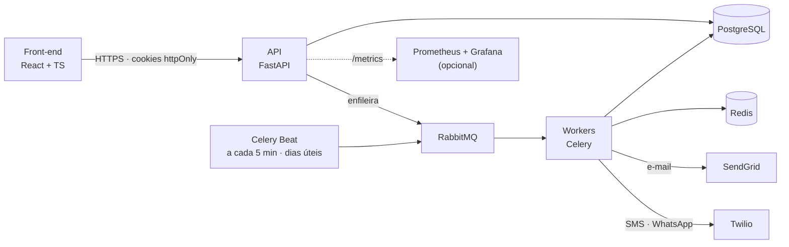

<p align="center">
  
</p>

<h1 align="center">Plataforma de Cobrança Automatizada</h1>

<p align="center">
  <strong>Trabalho de Conclusão de Curso — Engenharia de Software · Católica SC</strong><br/>
  SaaS Fintech B2B · Régua de cobrança multicanal · Processamento assíncrono<br/>
  Desenvolvido em parceria com a <strong>Consulth</strong>
</p>

<p align="center">
  
  
  
  
  
</p>
<p align="center">
  
  
  
  
  
  
  
</p>
<p align="center">
  
  
  
  
</p>

---

<p align="center">
  <a href="#sobre-o-projeto">Sobre</a> ·
  <a href="#destaques-técnicos">Destaques</a> ·
  <a href="#arquitetura">Arquitetura</a> ·
  <a href="#funcionalidades">Funcionalidades</a> ·
  <a href="#regras-de-negócio">Regras de Negócio</a> ·
  <a href="#stack-tecnológica">Stack</a>
  <br/>
  <a href="#segurança-e-lgpd">Segurança e LGPD</a> ·
  <a href="#qualidade-e-cicd">Qualidade e CI/CD</a> ·
  <a href="#como-executar">Como Executar</a> ·
  <a href="#status-do-projeto">Status</a> ·
  <a href="#design-system">Design System</a> ·
  <a href="#documentação">Documentação</a>
</p>

---

## Sobre o Projeto

Empresas B2B que operam carteiras de cobrança ainda dependem, em boa parte, de planilhas soltas e disparos manuais para tratar a inadimplência. O processo é lento, sujeito a erro humano e não escala.

A **Plataforma de Cobrança Automatizada** resolve isso com um pipeline auditável de ponta a ponta:

1. **Importa** lotes de devedores (CSV, XLSX, XLS) e valida cada linha;
2. **Aplica** uma régua de cobrança configurável (dias de atraso × canal × horário × template);
3. **Dispara** mensagens por **e-mail (SendGrid)**, **SMS** e **WhatsApp (Twilio)**, com reenvios automáticos;
4. **Acompanha** tudo em um dashboard com taxas de entrega e conversão.

O projeto foi construído como um produto SaaS de verdade: arquitetura orientada a filas, controle de acesso por perfil, trilha de auditoria, conformidade com a LGPD, testes automatizados e pipeline de CI com Quality Gate.

---

## Destaques Técnicos

- **Processamento assíncrono** — importação e disparos rodam em workers Celery via RabbitMQ; a API responde na hora e o front acompanha o progresso por polling.
- **Agendamento com regras de negócio** — o Celery Beat avalia a régua a cada 5 minutos, apenas em dias úteis e dentro da janela comercial (08h–19h, horário de Brasília).
- **Resiliência no envio** — até 4 tentativas com intervalo de 30 min; contatos inválidos são marcados como `bounce` e não são reenviados.
- **Autenticação segura** — tokens em **cookies httpOnly** (o JavaScript nunca vê o token), com refresh rotativo, bloqueio por excesso de tentativas (HTTP 429) e CORS restrito por origem.
- **RBAC + auditoria** — três perfis (administrador, gestor, operador) aplicados na API e refletidos na interface; ações sensíveis ficam registradas.
- **LGPD por design** — valor da dívida criptografado no banco, exclusão de titular sob demanda e cuidado para não expor CPF/CNPJ em logs.
- **Qualidade garantida no merge** — `main` protegida por Ruleset: exige PR e aprovação dos checks de testes, SonarCloud, migrações em PostgreSQL, build Docker e front-end.

---

## Arquitetura



**Fluxo de dados**

1. **Ingestão** — o usuário envia a planilha pelo portal (`POST /lotes/upload`).
2. **Mensageria** — o lote é enfileirado no RabbitMQ, sem bloquear a API.
3. **Processamento** — workers validam linha a linha (CPF/CNPJ, valores, datas, contatos) e gravam no PostgreSQL. Reimportar um CPF/CNPJ existente **atualiza** o cadastro.
4. **Orquestração** — o Celery Beat identifica os devedores elegíveis para cada regra ativa da régua.
5. **Disparo** — as mensagens são interpoladas com os dados do devedor e enviadas pelos provedores; falhas temporárias entram na fila de reenvio.
6. **Acompanhamento** — jobs, comunicações e indicadores ficam disponíveis no dashboard e no console de monitoramento.

---

## Funcionalidades

### 🔐 Autenticação e sessão
- Login com sessão em cookies httpOnly, renovação automática do token (refresh em caso de 401) e logout.
- Rotas protegidas por perfil e troca da própria senha.

### 📊 Dashboard
- KPIs consolidados: devedores na base, disparos, taxa de entrega (meta de 95%), taxa de conversão e falhas.
- Linha do tempo dos últimos 7 dias, distribuição por canal e últimos lotes importados.
- Indicadores sem base de cálculo são exibidos como "—" em vez de valores enganosos.

### 📥 Importação de lotes
- Upload de CSV, XLSX e XLS com acompanhamento do progresso em tempo real.
- Relatório de validação por linha, com a regra violada, e download do CSV de erros.
- Contadores de registros importados, atualizados e rejeitados.

### 👤 Devedores
- Listagem com busca por nome ou CPF/CNPJ, filtros por status e atraso mínimo, e paginação.
- Detalhe do devedor com histórico completo de comunicações.
- Troca de status (marcar como **quitado** só para gestor/administrador) e exclusão LGPD (só administrador).

### 📏 Régua de cobrança
- CRUD de regras por canal, dias de atraso, horário de disparo e template.
- Variáveis dinâmicas (`{nome}`, `{primeiro_nome}`, `{valor}`, `{data_vencimento}`, `{dias_atraso}`) com **pré-visualização** da mensagem.
- Ativação/desativação com tratamento de conflito (uma regra ativa por canal e dia de atraso).
- Consulta de devedores elegíveis e **execução manual** da regra.

### 🖥️ Monitoramento
- Acompanhamento de jobs de disparo e das comunicações geradas, com atualização por polling.
- Métricas de infraestrutura expostas em `/metrics` (Prometheus) e saúde dos serviços em `/health`.

### 👥 Usuários e auditoria
- CRUD de usuários, ativação/desativação e redefinição de senha.
- Gestores administram operadores; administradores administram todos.
- Trilha de auditoria filtrável por usuário, ação, entidade e período (só administrador).

---

## Regras de Negócio

| Regra | Descrição |
|---|---|
| Janela de disparo | Seg–sex, 08h–19h (Brasília); horário de cada regra entre 08:00 e 20:00 |
| Elegibilidade | Atraso exatamente igual ao da regra, devedor `ativo` ou `comunicado` e contato válido para o canal |
| Limite diário | No máximo uma comunicação bem-sucedida por canal, por devedor, por dia |
| Reenvio | Até 4 tentativas, com 30 min de intervalo |
| Bounce | E-mail ou telefone inválido encerra as tentativas para aquele contato |
| Unicidade da régua | Uma regra ativa por combinação de canal e dias de atraso; toda regra nasce inativa |
| Limite de template | SMS 480 · WhatsApp 1.024 · e-mail 5.000 caracteres |
| Quitação | Devedor quitado não é reaberto nem reimportado |

**Status do devedor:** `ativo` · `comunicado` · `negociando` · `quitado` · `inativo`
**Status da comunicação:** `pendente` · `enviado` · `entregue` · `falha` · `bounce`

---

## Stack Tecnológica

### Front-end
| Camada | Tecnologia | Papel |
|---|---|---|
| Build & Framework | React 18 + Vite | SPA com HMR e bundle otimizado |
| Linguagem | TypeScript (strict) | Tipagem dos modelos e das respostas da API |
| Estilo | Tailwind CSS | Design system corporativo |
| Sessão | Context API + cookies httpOnly | Rotas protegidas e refresh automático |
| Qualidade | ESLint · `tsc --noEmit` · Vitest + Testing Library | Lint, checagem de tipos e testes |

### Back-end
| Camada | Tecnologia | Papel |
|---|---|---|
| API | FastAPI (Python 3.14) | REST com documentação OpenAPI autogerada |
| ORM & Migrações | SQLAlchemy 2.1 + Alembic | Modelagem e versionamento do banco |
| Processamento | Pandas | Validação de lotes de importação |
| Filas & Agendamento | RabbitMQ + Celery (worker e beat) + Redis | Execução assíncrona e tarefas periódicas |
| Persistência | PostgreSQL 15 | Banco relacional principal |
| Provedores | SendGrid · Twilio | E-mail, SMS e WhatsApp |
| Observabilidade | Prometheus + Grafana | Métricas da aplicação (opcional) |
| Infraestrutura | Docker + Docker Compose | Ambiente reproduzível |

---

## Segurança e LGPD

- Tokens de acesso (15 min) e refresh (7 dias, com rotação) em cookies httpOnly.
- Senhas de 8 a 128 caracteres, com ao menos uma letra e um número; bloqueio temporário após 5 tentativas de login malsucedidas.
- CORS restrito às origens configuradas, com credenciais habilitadas.
- Valor da dívida armazenado de forma criptografada.
- Exclusão de dados do titular (LGPD) restrita ao administrador e registrada na auditoria.

---

## Qualidade e CI/CD

| Categoria | Ferramenta / Escopo | Situação |
|---|---|---|
| **CI** | GitHub Actions a cada PR e na `main` | ✅ Em funcionamento |
| **Testes (back-end)** | `pytest` — 783 testes | ✅ ~97% de cobertura (mínimo exigido: 80%) |
| **Testes (front-end)** | Vitest + Testing Library (cliente da API e contexto de autenticação) | ✅ No CI |
| **Lint e tipos (front-end)** | ESLint + `tsc --noEmit` | ✅ No CI |
| **Migrações** | Alembic aplicado em PostgreSQL 15 real | ✅ No CI |
| **Build** | Imagem Docker | ✅ No CI |
| **Análise estática** | SonarCloud com Quality Gate | ✅ Em PRs e na `main` |
| **Deploy** | AWS (RDS + EC2) | 📋 Planejado |

**Fluxo de trabalho:** git-flow (`feature/*` → `develop` → PR para `main`) e commits no padrão [Conventional Commits](https://www.conventionalcommits.org/pt-br/). A `main` é protegida e só recebe código via Pull Request com todos os checks aprovados.

---

## Como Executar

**Pré-requisitos:** Docker e Docker Compose, Node.js (LTS) e Git.

### 1. Back-end

```bash
git clone https://github.com/MarieleV/PlataformaCobranca.git
cd PlataformaCobranca/back-end
cp .env.example .env              # no PowerShell: Copy-Item .env.example .env
docker compose up -d --build
```

As migrações são aplicadas automaticamente ao subir a API. Para criar o usuário administrador de desenvolvimento:

```bash
docker exec -it cobranca_api python -m app.seed
```

> Login de desenvolvimento: `admin@consulth.com.br` / `admin123` — **apenas para ambiente local.**

### 2. Front-end

```bash
cd ../front-end
npm install
npm run dev
```

| Serviço | Endereço |
|---|---|
| Front-end | http://localhost:5173 |
| API | http://localhost:8000 |
| Documentação interativa (Swagger) | http://localhost:8000/docs |
| Saúde dos serviços | http://localhost:8000/health |

### Modo de demonstração

Por padrão o envio real fica **desligado** (`ENVIO_SIMULADO=true`), então é possível explorar todo o fluxo sem custo com provedores. O simulador reage ao contato informado:

| Contato | Resultado simulado |
|---|---|
| E-mail iniciado por `bounce` ou telefone terminado em `0000` | `bounce` |
| E-mail iniciado por `falha` ou telefone terminado em `9999` | Falha temporária (entra em reenvio) |
| Qualquer outro | `enviado` |

### Testes

```bash
# Back-end (com o ambiente virtual ativado)
cd back-end
pip install -r requirements-dev.txt
pytest

# Front-end
cd front-end
npm run lint
npx tsc --noEmit
npm test
```

### Monitoramento (opcional)

```bash
cd back-end
docker compose -f docker-compose.yml -f docker-compose.monitoring.yml up -d
```

Prometheus em http://localhost:9090 e Grafana em http://localhost:3000.

---

## Status do Projeto

| Módulo | Status |
|---|---|
| Autenticação, sessão e RBAC | ✅ Concluído |
| Importação e validação de lotes | ✅ Concluído |
| Gestão de devedores (incl. LGPD) | ✅ Concluído |
| Régua de cobrança (motor de regras) | ✅ Concluído |
| Disparo multicanal com reenvios | ✅ Concluído (modo simulado por padrão) |
| Dashboard e indicadores | ✅ Concluído |
| Console de monitoramento | ✅ Concluído (dados reais da API) |
| Usuários e auditoria | ✅ Concluído |
| CI/CD com Quality Gate | ✅ Concluído |
| Validação com provedores reais (SendGrid/Twilio) | 🚧 Em andamento |
| Deploy em nuvem (AWS) | 📋 Planejado |
| Webhooks de confirmação de entrega | 📋 Planejado |
| Templates aprovados do WhatsApp (produção) | 📋 Planejado |

---

## Design System

A interface segue um padrão **SaaS corporativo**, inspirado em ferramentas como Vercel e Stripe.

- **UI limpa e monocromática** — paleta em tons de slate (`slate-50` nos fundos, preto nos botões primários e painéis de destaque).
- **Menos carga cognitiva** — cores vivas (azul, verde, roxo, vermelho) aparecem só em tons pastéis, reservadas a status e canais (e-mail, SMS, WhatsApp).
- **Componentes consistentes** — cantos arredondados (`rounded-2xl`/`rounded-3xl`), sombras suaves (`shadow-black/10`) e tipografia `Inter`.

Wireframes e protótipos no [Figma do projeto](https://www.figma.com/design/aTgE91sZyzbxTrB8kh5clh/Plataforma-de-Cobran%C3%A7a-Automatizada).

---

## Documentação

| Documento | Conteúdo |
|---|---|
| [`docs/RFC`](./docs) | Requisitos funcionais, regras de negócio e requisitos não funcionais (RFC v1.1) |
| [`back-end/DOC.md`](./back-end/DOC.md) | Execução, testes, CI/CD, métricas, regras e limitações conhecidas |
| `http://localhost:8000/docs` | Referência interativa de todos os endpoints (OpenAPI) |

---

<p align="center">
  <sub>Desenvolvido por <strong>Mariele</strong> como Trabalho de Conclusão de Curso — Engenharia de Software, Católica SC, em parceria com a Consulth · 2026</sub>
</p>
