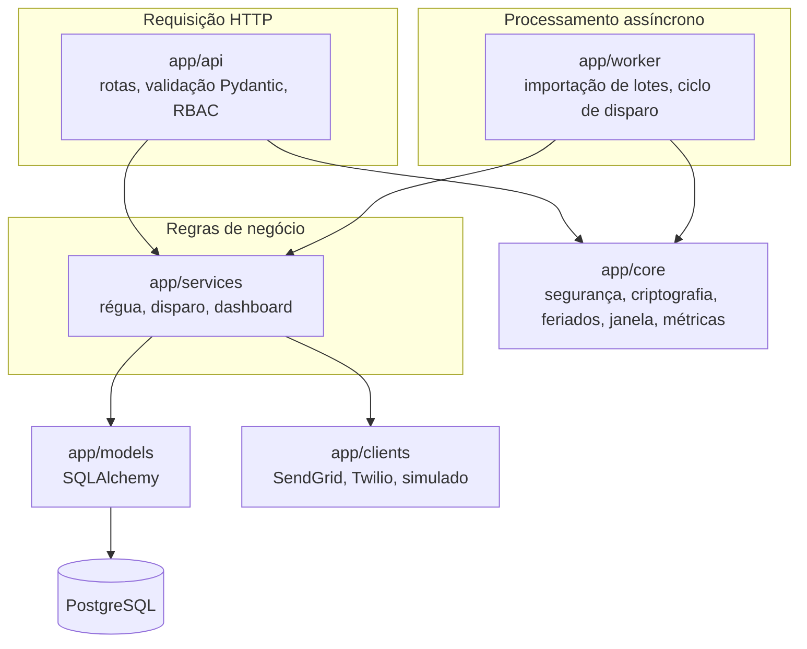
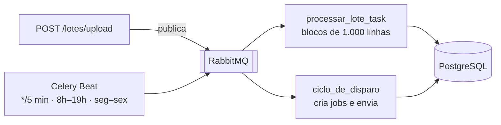

<div align="center">

# Back-end

**API REST, processamento assíncrono e motor da régua de cobrança**


<sub>[README](../README.md) · [RFC](../docs/RFC.md) · **Back-end** · [Front-end](../front-end/README.md) · [Deploy](../deploy/README.md) · [Teste de carga](../carga/README.md)</sub>

</div>

---

## Visão geral

| | |
|---|---|
| **41 endpoints** | Autenticação, lotes, devedores, régua, jobs, dashboard, usuários, auditoria e saúde |
| **8 tabelas** | Esquema versionado por 5 migrações Alembic, aplicadas automaticamente ao subir a API |
| **2 processos assíncronos** | Worker Celery (importação e disparos) e Celery Beat (ciclo da régua a cada 5 minutos) |
| **3 canais** | E-mail (SendGrid), SMS e WhatsApp (Twilio), com cliente simulado para desenvolvimento |
| **789 testes** | ~97% de cobertura; o CI exige no mínimo 80% (RNF06) |

## Arquitetura



| Pacote | Responsabilidade |
|---|---|
| `app/api` | Uma rota por recurso (`auth`, `lotes`, `devedores`, `regras`, `jobs`, `dashboard`, `usuarios`, `auditoria`); checagem de perfil com `role_required` |
| `app/services` | Elegibilidade da régua, criação idempotente de jobs, envio com reenvio e cálculo dos indicadores |
| `app/worker` | Tarefas Celery: leitura e validação de planilhas (`tasks`, `validadores`) e ciclo de disparo (`disparo_tasks`) |
| `app/clients` | Um cliente por provedor, com interface comum; o simulado reage ao contato para testes |
| `app/core` | Configuração, JWT e cookies, Fernet, limite de login, calendário de feriados, janela de disparo, métricas e auditoria |
| `app/schemas` | Contratos de entrada e saída da API (Pydantic) |

<details>
<summary><b>Estrutura de pastas</b></summary>

```text
back-end/
├── app/
│   ├── api/              rotas FastAPI
│   ├── services/         regras de negócio
│   ├── worker/           tarefas Celery e validadores de linha
│   ├── clients/          SendGrid, Twilio e simulado
│   ├── core/             configuração, segurança, criptografia, calendário, métricas
│   ├── models/           modelos SQLAlchemy
│   ├── schemas/          modelos Pydantic
│   ├── main.py           aplicação FastAPI, middlewares e /health
│   ├── seed.py           cria o administrador inicial
│   └── testar_provedores.py  envio de teste real por canal
├── alembic/              migrações 0001 a 0005
├── monitoring/           Prometheus e Grafana (opcional)
├── tests/                pytest (SQLite temporário + Redis simulado)
├── docker-compose.yml    ambiente de desenvolvimento
└── Dockerfile
```

</details>

---

## Como executar

> [!IMPORTANT]
> Pré-requisitos: **Docker Desktop** com a Engine rodando e **Git**. Para rodar os testes fora do Docker, **Python 3.14**.

**1. Configurar o ambiente**

```powershell
cd back-end
Copy-Item .env.example .env
python -c "import secrets; print(secrets.token_urlsafe(48))"                               # JWT_SECRET
python -c "from cryptography.fernet import Fernet; print(Fernet.generate_key().decode())"  # ENCRYPTION_KEY
```

Cole os dois valores no `.env`. Mantenha `ENVIO_SIMULADO=true` enquanto não houver chaves dos provedores.

**2. Subir os serviços**

```powershell
docker compose up -d --build
docker compose exec api alembic current      # deve mostrar 0005 (head)
```

**3. Criar o administrador de desenvolvimento**

```powershell
docker exec -it cobranca_api python -m app.seed
```

Login: `admin@consulth.com.br` / `admin123`. Em produção o seed usa `ADMIN_SENHA_INICIAL` e **recusa** a senha padrão.

| Serviço | Endereço |
|---|---|
| API | <http://localhost:8000> |
| Documentação interativa (Swagger) | <http://localhost:8000/docs> |
| Esquema OpenAPI | <http://localhost:8000/openapi.json> |
| Saúde (PostgreSQL, Redis, RabbitMQ) | <http://localhost:8000/health> |
| Métricas Prometheus | <http://localhost:8000/metrics> |
| PostgreSQL | `localhost:5433` (5432 no contêiner) |
| RabbitMQ (AMQP / painel) | `localhost:5672` / <http://localhost:15672> |
| Redis | `localhost:6379` |

> [!TIP]
> Em máquinas com pouca memória, o RabbitMQ pode demorar a ficar saudável e o `up` falhar com "dependency rabbitmq failed to start". Não é defeito: rode `docker compose up -d` de novo, sem `--build`.

<details>
<summary><b>Variáveis de ambiente</b></summary>
<br/>

| Grupo | Variáveis | Observação |
|---|---|---|
| Ambiente | `ENVIRONMENT` | `production` liga as validações de segurança (ver abaixo) |
| Banco e fila | `POSTGRES_USER`, `POSTGRES_PASSWORD`, `POSTGRES_DB`, `RABBITMQ_USER`, `RABBITMQ_PASSWORD` | Em produção, `DATABASE_URL` com `?sslmode=require` |
| Segurança | `JWT_SECRET`, `ENCRYPTION_KEY` | A `ENCRYPTION_KEY` cifra o valor das dívidas: perdê-la é perder os valores |
| Sessão | `CORS_ORIGINS`, `COOKIE_SECURE`, `COOKIE_SAMESITE`, `REFRESH_COOKIE_PATH` | Nunca use `*` em `CORS_ORIGINS` (há credenciais) |
| Régua | `MAX_TENTATIVAS_ENVIO`, `INTERVALO_REENVIO_MINUTOS`, `JANELA_INICIO_HORA`, `JANELA_FIM_HORA` | Padrões do RFC: 4 tentativas, 30 min, 8h às 20h |
| Provedores | `SENDGRID_API_KEY`, `EMAIL_REMETENTE`, `TWILIO_ACCOUNT_SID`, `TWILIO_AUTH_TOKEN`, `TWILIO_SMS_FROM`, `TWILIO_WHATSAPP_FROM`, `ENVIO_SIMULADO`, `ENVIO_REAL_CANAIS` | Com `ENVIO_SIMULADO=false`, só os canais de `ENVIO_REAL_CANAIS` (padrão: os três) usam o provedor real; os outros continuam simulados. Em produção, só as chaves desses canais são obrigatórias |
| Opcionais | `METRICS_TOKEN`, `FERIADOS_EXTRAS`, `FERIADOS_FACULTATIVOS`, `ADMIN_EMAIL`, `ADMIN_SENHA_INICIAL`, `GRAFANA_ADMIN_PASSWORD` | `METRICS_TOKEN` exige `Authorization: Bearer` no `/metrics` |

Com `ENVIRONMENT=production`, a API **se recusa a subir** sem `COOKIE_SECURE=true`, sem `sslmode=require` no banco ou com a senha padrão do administrador.

</details>

---

## API

Todas as rotas exigem login, exceto `POST /auth/login`, `/`, `/health` e `/metrics`. Formatos completos em `/docs`.

| Recurso | Rotas | Perfis |
|---|---|---|
| **Autenticação** | `POST /auth/login` · `POST /auth/refresh` · `DELETE /auth/logout` · `GET /auth/me` · `PUT /auth/senha` | todos |
| **Lotes** | `POST /lotes/upload` · `GET /lotes/` · `GET /lotes/{id}` · `GET /lotes/{id}/erros` · `GET /lotes/{id}/erros/csv` | todos |
| **Devedores** | `GET /devedores/` (`status`, `atraso_minimo`, `canal`, `busca`, paginação) · `GET /devedores/{id}` · `GET /devedores/{id}/comunicacoes` · `PATCH /devedores/{id}/status` · `DELETE /devedores/{id}` | leitura: todos · `quitado`: gestor e admin · exclusão: admin |
| **Régua** | CRUD em `/regras/` · `POST /regras/{id}/ativar` e `/desativar` · `GET /regras/status` · `GET /regras/variaveis` · `POST /regras/preview` · `GET /regras/{id}/elegiveis` · `POST /regras/{id}/executar` | consulta: todos · alteração: gestor e admin |
| **Jobs** | `GET /jobs/` · `GET /jobs/{id}` · `GET /jobs/{id}/comunicacoes` | todos |
| **Dashboard** | `GET /dashboard/?dias=7` (1 a 30) | todos |
| **Usuários** | CRUD em `/usuarios/` · `POST /usuarios/{id}/ativar`, `/desativar`, `/redefinir-senha` | gestor (só operadores) e admin |
| **Auditoria** | `GET /auditoria/` (`usuario_id`, `acao`, `entidade`, `de`, `ate`) | admin |

**Autenticação.** O login grava dois cookies `httpOnly`: acesso (15 min) e refresh (7 dias, `path=/auth`, com rotação). O cliente envia as requisições com `credentials: "include"`; em 401, chama `POST /auth/refresh` uma vez. Logout, troca de senha e desativação revogam as sessões no Redis. Cinco falhas de login seguidas, por IP e e-mail, bloqueiam temporariamente (HTTP 429).

---

## Processamento assíncrono



- **Confiabilidade:** `task_acks_late=True` (a mensagem só sai da fila depois que a tarefa termina) e `worker_prefetch_multiplier=1` (um lote longo não fica reservado para um worker ocupado). Por isso as tarefas são idempotentes.
- **Importação:** pandas lê `.csv`, `.xlsx` (`openpyxl`) e `.xls` (`xlrd`); cada linha passa por `validar_linha` e pode ter vários erros; a cada 1.000 linhas o progresso é gravado. CPF/CNPJ já existente **atualiza** o devedor (exceto quitado).
- **Disparo:** a criação do job trava a regra (`SELECT … FOR UPDATE`) e o banco tem restrição única por regra e dia; cada comunicação é reservada com `FOR UPDATE SKIP LOCKED`, então vários workers não enviam a mesma mensagem.
- **Calendário:** o ciclo não dispara em feriados nacionais (incluindo a Sexta-feira Santa), nos facultativos Carnaval e Corpus Christi (`FERIADOS_FACULTATIVOS`, ligado por padrão) e nas datas de `FERIADOS_EXTRAS`.

<details>
<summary><b>Regras de negócio implementadas</b></summary>
<br/>

| Regra | Implementação |
|---|---|
| Elegibilidade | Atraso **exatamente** igual ao da regra, status `ativo` ou `comunicado` e contato do canal preenchido (`tem_contato_do_canal`) |
| RN03 | No máximo uma comunicação bem-sucedida por devedor, canal e dia |
| RN05 | Segunda a sexta, exceto feriados, 08h às 20h (Brasília); o ciclo roda das 8h às 19h55 |
| RN07 / RN08 | Até 4 tentativas a cada 30 minutos; contato inválido (*bounce*) é falha definitiva |
| Régua | Toda regra nasce inativa; uma regra ativa por canal e dias de atraso (HTTP 409); regra com jobs não é excluída, só desativada |
| Status | Só gestor e administrador marcam `quitado`; quitado não reabre nem é atualizado por reimportação |
| Dashboard | Taxa de entrega = sucesso ÷ comunicações geradas no período; conversão = devedores alcançados que hoje estão quitados |

</details>

---

## Testes

Rodam sem Docker: banco SQLite temporário e Redis simulado.

```powershell
python -m venv venv
venv\Scripts\Activate.ps1
python -m pip install -r requirements-dev.txt
pytest --cov=app --cov-report=term
```

| Área | Exemplos do que é verificado |
|---|---|
| Segurança | Cookies, rotação e revogação de refresh, bloqueio após 5 falhas, RBAC por rota, validações de produção |
| Importação | Validadores de CPF/CNPJ, datas, valores e contatos; processamento em blocos; reimportação; erros estruturais |
| Régua e disparo | Elegibilidade, RN03, janela e feriados, reenvios, *bounce*, idempotência dos jobs, concorrência |
| API | Paginação, filtros (incluindo canal), códigos 401/403/404/409/422, auditoria das ações sensíveis |
| Migrações | Esquema aplicado do zero e coerente com os modelos |

---

## CI/CD

O workflow `.github/workflows/ci.yml` roda a cada push e pull request:

| Job | O que garante |
|---|---|
| **Testes e SonarCloud** | pytest com cobertura mínima de 80% e Quality Gate do SonarCloud (em PRs e na `main`) |
| **Migrações no PostgreSQL** | Migrações aplicadas num PostgreSQL 15 real, `alembic check` (modelos e esquema em sincronia) e desfazer/refazer |
| **Build da imagem Docker** | Imagens da API e do front, `Caddyfile` e compose de produção válidos |
| **Front-end** | Lint, tipos, testes com cobertura mínima de 80% e build |
| **Deploy** | Só na `main`, depois dos quatro anteriores e com aprovação manual: publica as imagens e atualiza a produção ([`deploy/`](../deploy/README.md)) |

---

## Observabilidade

- **Métricas** em `/metrics` (formato Prometheus): requisições e duração por rota (`cobranca_http_requests_total`, `cobranca_http_request_duration_seconds`) e indicadores de negócio. Com `METRICS_TOKEN`, a rota exige `Authorization: Bearer <token>`; em produção ela não é publicada.
- **Prometheus e Grafana** (opcional):

  ```powershell
  docker compose -f docker-compose.yml -f docker-compose.monitoring.yml up -d
  ```

  Prometheus em <http://localhost:9090> e Grafana em <http://localhost:3000>.

---

## Provedores reais

Com as chaves no `.env`, envie **uma** mensagem de teste por canal, sem tocar no banco e sem desligar o modo simulado:

```powershell
docker compose up -d --force-recreate api
docker compose exec api python -m app.testar_provedores email seu-email@exemplo.com
docker compose exec api python -m app.testar_provedores sms 47999990000
docker compose exec api python -m app.testar_provedores whatsapp 47999990000
```

Só depois de validar troque para `ENVIO_SIMULADO=false`. Para ligar só alguns canais, use `ENVIO_REAL_CANAIS` (ex.: `ENVIO_REAL_CANAIS=email`: SendGrid real, SMS e WhatsApp simulados). Em produção, a API só exige as chaves dos canais listados.

> [!NOTE]
> No modo simulado, e-mail começando com `bounce` ou telefone terminando em `0000` gera *bounce*; e-mail começando com `falha` ou telefone terminando em `9999` gera falha temporária (com reenvio). Os demais contatos são "enviados".

---

## Limitações conhecidas

- Se o sistema ficar fora do ar o dia inteiro, o job daquele dia não é criado depois; use `POST /regras/{id}/executar` (até 7 dias para trás).
- O status `entregue` depende de webhooks dos provedores (não implementados): hoje "enviado" significa aceito pelo provedor.
- Não há totais em R$ no dashboard, porque o valor da dívida é criptografado.
- Os logs de auditoria não têm expurgo automático (a proposta previa 90 dias).

<details>
<summary><b>Comandos úteis</b></summary>

```powershell
docker compose ps                       # estado dos serviços
docker compose logs -f api              # logs (api, worker, beat)
docker compose restart worker           # reiniciar um serviço
docker compose down                     # parar tudo
docker image prune -f                   # limpar imagens órfãs
```

</details>
