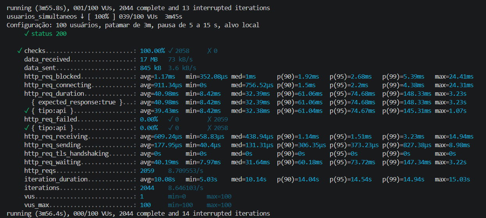
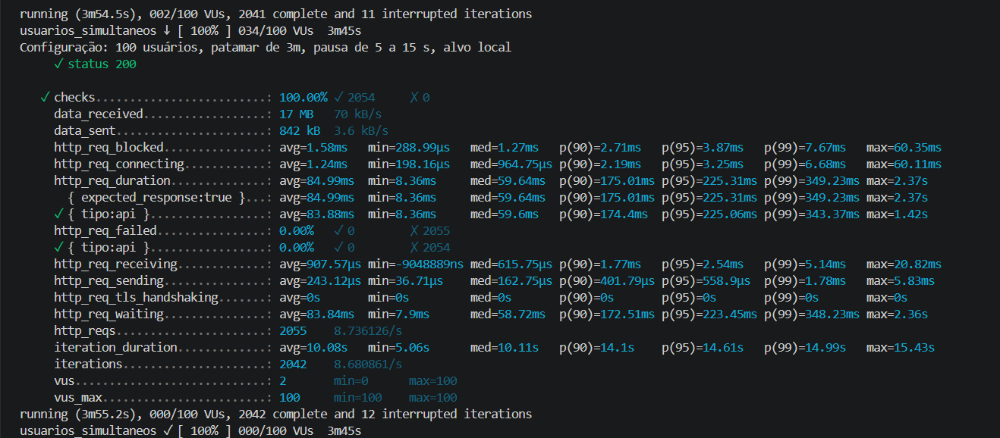
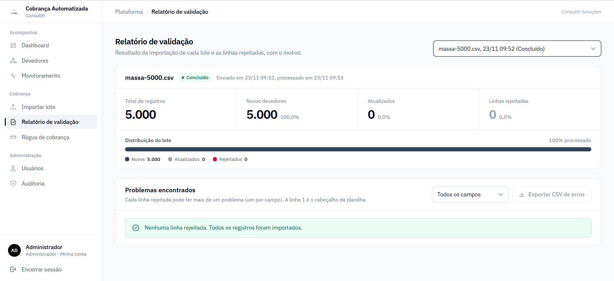
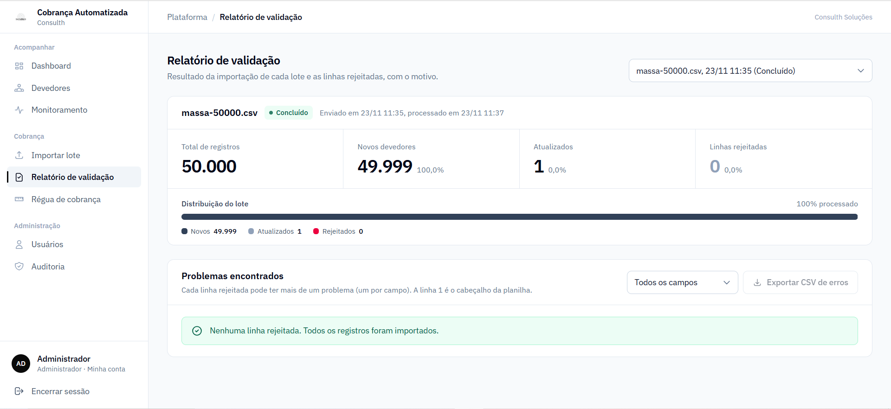
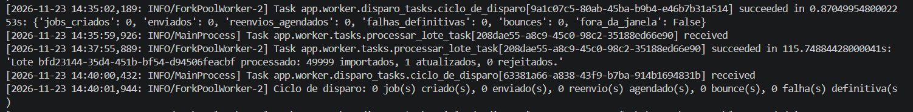
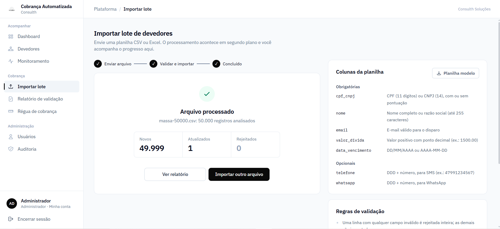

<div align="center">

# Teste de carga

**Evidência dos requisitos de desempenho: 100 usuários simultâneos, P95 < 300 ms e lotes de 50.000 registros**


<sub>[README](../README.md) · [RFC](../docs/RFC.md) · [Back-end](../back-end/DOC.md) · [Front-end](../front-end/README.md) · [Deploy](../deploy/README.md) · **Teste de carga**</sub>

</div>

Evidência dos requisitos não funcionais de desempenho do [RFC](../docs/RFC.md#24-requisitos-não-funcionais):

| Requisito | O que o RFC pede | Como é verificado |
|---|---|---|
| **RNF01** | Ao menos 100 usuários simultâneos sem degradação | 100 usuários virtuais navegando ao mesmo tempo por 3 min (5 a 15 s entre ações; ver [Ritmo dos usuários](#ritmo-dos-usuários)); aprovado se < 1% das requisições falharem |
| **RNF02** | Rotas da API < 300 ms no P95 | Aprovado se o percentil 95 do tempo de resposta for < 300 ms |
| **RNF03** | Arquivos de até 50.000 registros | Importar um lote de 50.000 devedores e registrar o tempo de processamento |

O RNF01 e o RNF02 são critérios automáticos (*thresholds*) do script: o próprio k6 diz se passou (✓) ou não (✗).

| Arquivo | Para quê |
|---|---|
| `rnf01-rnf02.js` | Script do [k6](https://grafana.com/docs/k6/): 100 usuários usando o painel (dashboard, devedores com filtros e busca, régua, jobs, lotes) |
| `gerar_massa.py` | Gera um CSV de devedores fictícios (CPFs válidos, e-mails `@example.com`) |
| `docker-compose.carga.yml` | Sobe a API local como em produção (2 processos, sem `--reload`) |
| `resultados/` | Onde o k6 grava o resumo de cada execução (`.txt` e `.json`; fora do git) |

O k6 roda pela imagem Docker oficial: não precisa instalar nada.

---

## Passo a passo (ambiente local, evidência oficial)

Comandos em PowerShell, a partir da raiz do repositório.

### 1. Subir o back-end como em produção

```powershell
cd back-end
docker compose -f docker-compose.yml -f ../carga/docker-compose.carga.yml up -d
docker compose ps        # api, worker, beat, postgres, redis, rabbitmq "healthy"/"running"
docker exec -it cobranca_api python -m app.seed   # só se o admin ainda não existir
cd ..
```

> Por que não o `docker compose up -d` de sempre? Em desenvolvimento a API roda com `--reload` e um processo só; medir assim subestimaria o sistema. O arquivo extra deixa a API igual à de produção.

### 2. Gerar e importar a massa de dados

```powershell
python carga/gerar_massa.py                      # 5.000 devedores -> carga/massa-5000.csv
```

Importe `carga/massa-5000.csv` pela tela **Importar lote** (`npm run dev` no `front-end`, <http://localhost:8443>) e espere o lote terminar (5.000 novos, 0 rejeitados). Com a base vazia, as consultas ficam artificialmente rápidas. Com milhares de devedores, o teste mede o que um usuário real enfrentaria.

Opcional: ative uma ou duas regras na Régua e use "Executar agora", para o Dashboard e o Monitoramento terem jobs e comunicações.

### 3. Rodar o teste

```powershell
cd carga
docker run --rm --network back-end_default -v "${PWD}:/scripts" -w /scripts -e BASE_URL=http://api:8000 -e EMAIL=admin@consulth.com.br -e SENHA=admin123 grafana/k6:1.0.0 run rnf01-rnf02.js
cd ..
```

Dura cerca de 4 minutos (30 s subindo até 100 usuários, 3 min no patamar, 15 s descendo). Ajustes opcionais: `-e VUS=150` (mais usuários), `-e DURACAO=5m` (patamar mais longo; no máximo 12 min, porque a sessão de acesso vale 15 min) e `-e PAUSA_MIN=1 -e PAUSA_MAX=3` (cenário de estresse; ver [Ritmo dos usuários](#ritmo-dos-usuários)).

> [!IMPORTANT]
> O k6 roda **na mesma rede Docker da API** (`--network back-end_default` e `BASE_URL=http://api:8000`), como o Caddy em produção. Pelo caminho `host.docker.internal`, no Windows, cada requisição sai do Docker, passa pelo redirecionamento de portas do Docker Desktop e volta: em 23/11/2026 isso derrubou 2,5% das requisições (que nem chegaram à API, com 100% de respostas 200 nos logs dela) e somou segundos à abertura de conexões. A medida ficava sendo da rede do Windows, não da API.

### 4. Ler o resultado

No fim, o k6 mostra o resumo. O que importa:

```text
  █ THRESHOLDS

    checks
    ✓ 'rate>0.99' rate=100.00%

    http_req_duration{tipo:api}
    ✓ 'p(95)<300' p(95)=XX.XXms          ← RNF02

    http_req_failed{tipo:api}
    ✓ 'rate<0.01' rate=0.00%             ← RNF01 (sem degradação com 100 usuários)
```

- **✓ em todos os limites:** requisitos atendidos. O comando termina com código 0.
- **✗ em algum:** o k6 termina com código 99. Veja a seção "Se reprovar".
- `http_reqs` mostra o total de requisições e a taxa por segundo; `vus_max` confirma os 100 usuários.
- O resumo também fica salvo em `carga/resultados/rnf01-rnf02-local-<data>.txt` e `.json`.

### 5. RNF03: lote de 50.000 registros

```powershell
python carga/gerar_massa.py --quantidade 50000 --semente 2026   # carga/massa-50000.csv (~5 MB)
```

Importe pela tela **Importar lote** e, ao terminar, abra o **Relatório de validação**: ele mostra "Enviado em ..." e "processado em ...". A diferença é o tempo de processamento, e o total deve ser 50.000 novos e 0 rejeitados. Faça a captura dessa tela.

> Importar os 50.000 **depois** do teste de carga, ou em uma base separada: com 55.000 devedores, as consultas do passo 3 ficam mais pesadas que o cenário planejado. Também é uma medição válida, mas registre qual foi o tamanho da base.

---

## Ritmo dos usuários

"100 usuários simultâneos" (RNF01) significa 100 pessoas com o painel aberto ao mesmo tempo, não 100 robôs clicando sem parar. Entre uma ação e outra (abrir o dashboard, filtrar ou paginar devedores, ver jobs), o operador lê a tabela ou o gráfico. O script sorteia uma pausa de **5 a 15 s** (média de 10 s) entre as ações de cada usuário.

O próprio front-end serve de referência: parado na tela, ele consulta a API **a cada 60 s no Dashboard** e **a cada 15 s no Monitoramento** (atualização automática). Uma pausa média de 10 s é mais frequente que isso, então o cenário continua conservador. Com 100 usuários, dá cerca de 9 requisições por segundo.

O **cenário de estresse** (`-e PAUSA_MIN=1 -e PAUSA_MAX=3`) gera cerca de 3 vezes mais requisições. Ele não é o critério do RNF01/RNF02: serve para mostrar o limite da máquina.

O resumo de cada execução começa com uma linha `Configuração:` (usuários, patamar, pausa), para que o número nunca fique sem o cenário que o produziu.

---

## Resultados

Medições de **23/11/2026**, ambiente local, k6 na rede Docker da API.

**Máquina:** notebook Intel Core i3-7020U (2 núcleos, 4 threads, 2,3 GHz, sem turbo), 4 GB de RAM e SSD, com Windows 10 e Docker Desktop (WSL 2: 4 CPUs e 1,8 GB para os contêineres). Na mesma máquina rodavam a API (2 processos, como em produção), o PostgreSQL, o Redis, o RabbitMQ, o worker, o beat e o próprio k6. Grafana e Prometheus estavam desligados.

**Base:** 5.042 devedores (massa de 5.000 do `gerar_massa.py` mais os de testes anteriores).

| Cenário | Pausa | Req/s | P95 da API | Falhas | Resultado |
|---|---|---|---|---|---|
| **Realista (RNF01/RNF02)** | 5–15 s | 8,7 | **75 ms** (99 ms em outra rodada) | **0,00%** | ✅ aprovado nos três limites (checks 100%) |
| **Realista, base de ~55.000** | 5–15 s | 8,7 | **225 ms** | **0,00%** | ✅ aprovado nos três limites (repetido depois do lote de 50.000) |
| Estresse | 1–3 s | 27,1 | 976 ms | 1,62% | ✗ acima do limite: capacidade da máquina esgotada |

- No cenário realista houve duas rodadas com a base de 5.042: P95 de 75 ms (mediana de 32 ms, P99 de 145 ms; [captura](#capturas)) e P95 de 99 ms (mediana de 42 ms, P99 de 778 ms). A diferença entre rodadas vem da máquina compartilhada com outros processos; as duas ficam bem abaixo do limite.
- Com a base 11 vezes maior (~55.000 devedores, depois do RNF03), o P95 subiu para 225 ms (mediana de 60 ms, P99 de 343 ms) e continuou abaixo do limite: as listagens são paginadas e as contagens usam índices.
- No estresse, os 2 processos da API ficam com a CPU no máximo (~175% no `docker stats`), e a fila faz parte das requisições esperar mais de 30 s por uma conexão com o banco. Em uma máquina com mais núcleos, ou com mais processos da API, o limite sobe.

### RNF03: lote de 50.000 registros

Importado em 23/11/2026, na mesma máquina, com a base já com 5.042 devedores:

| Medida | Resultado |
|---|---|
| Registros no arquivo | 50.000 (`massa-50000.csv`, semente 2026) |
| Novos / atualizados / rejeitados | 49.999 / 1 / **0** |
| Tempo de processamento (worker) | **115,7 s** (log do Celery: `processar_lote_task ... succeeded in 115.75s`) |
| Vazão | **~25.900 registros/min** (meta do RFC: > 10.000/min) ✅ |

O "1 atualizado" é um CPF sorteado que já existia na base (a chance de uma coincidência entre 50.000 sorteios e ~5.000 CPFs existentes é de uns 25%). O sistema atualizou o devedor em vez de duplicá-lo, como manda a regra de reimportação. A tela do Relatório de validação mostra só horas e minutos ("Enviado em 23/11 11:35, processado em 23/11 11:37"); o tempo exato vem do log do worker (`docker logs cobranca_worker`).

> Use outra semente (`--semente`) para o lote grande: com a semente padrão (42), os 5.000 primeiros registros repetem a massa de 5.000 e entram como "atualizados".

### Capturas

Evidências das execuções de 23/11/2026 (imagens em [`docs/imagens/carga/`](../docs/imagens/carga/)).

**RNF01/RNF02: resumo do k6, base de 5.042 devedores** (P95 de 74,67 ms, 0% de falhas, checks 100%):



**RNF01/RNF02: resumo do k6, base de ~55.000 devedores** (depois do lote de 50.000; P95 de 225,06 ms, 0% de falhas):



<details>
<summary><b>Massa do teste de carga: lote de 5.000 registros</b></summary>



</details>

**RNF03: lote de 50.000 registros**. O Relatório de validação mostra 49.999 novos, 1 atualizado e 0 rejeitados:



O log do worker mostra o tempo exato de processamento, `succeeded in 115.75s`:



<details>
<summary><b>Tela de importação ao final do lote de 50.000</b></summary>



</details>

### O que o teste revelou e foi corrigido

As primeiras execuções (pausa de 1 a 3 s, via `host.docker.internal`) reprovaram com P95 de 5,4 s e 3,1% de falhas. A investigação encontrou três problemas, corrigidos antes da medição acima:

1. **Dashboard com consultas em excesso:** a linha do tempo fazia uma consulta por dia (30 com `dias=30`), passando de 35 idas ao banco por requisição. Agora o gráfico e a conversão usam uma consulta cada, e a rota caiu de 150–250 ms para 40–60 ms sem carga.
2. **Conexão presa entre a autenticação e a rota:** com rotas síncronas, o FastAPI roda a dependência de login e a rota em threads diferentes (40 por processo), e o pool tem 10 conexões. A conexão ficava presa entre as duas etapas, e sob carga as requisições esperavam umas pelas outras até o timeout de 30 s do pool. Agora o `get_current_user` devolve a conexão antes de a rota rodar.
3. **Rede do Windows na medição:** o caminho `host.docker.internal` derrubava requisições que nem chegavam à API. Agora o k6 roda na rede Docker da API.

Também foi desligado o *busy-wait* do Erlang no RabbitMQ, que gastava CPU com a fila vazia (em produção, isso economiza crédito de CPU da `t3.small`).

---

## Evidências para o TCC

1. Captura do resumo do k6 com os limites aprovados (✓), mais o arquivo `.txt` de `carga/resultados/`.
2. Ambiente da medição: máquina (processador e memória), tamanho da base (ex.: 5.000 devedores) e API com 2 processos.
3. Opcional, gráfico no Grafana durante o teste. Suba o monitoramento junto:

   ```powershell
   cd back-end
   docker compose -f docker-compose.yml -f ../carga/docker-compose.carga.yml -f docker-compose.monitoring.yml up -d
   ```

   No Grafana (<http://localhost:3000>), em *Explore*, use a consulta abaixo (P95 por minuto, em segundos):

   ```promql
   histogram_quantile(0.95, sum by (le) (rate(cobranca_http_request_duration_seconds_bucket[1m])))
   ```

   Com 2 processos, cada coleta do Prometheus lê as métricas de um processo só. O gráfico é uma amostra; o número oficial é o do k6.
4. RNF03: captura do Relatório de validação do lote de 50.000.

---

## Contra a produção (opcional, com cuidado)

O resultado em produção **não substitui** o local para o RNF02. O k6 mede do seu computador, então o tempo inclui a ida e volta até Ohio (~120–150 ms) e o TLS, que não são tempo da API. Se quiser rodar mesmo assim, por exemplo para mostrar que a infraestrutura aguenta 100 usuários (RNF01):

- Só depois que o filtro por canal (RF05) estiver em produção. Antes disso, a rota com `canal=` devolve 422 e conta como falha.
- Use um patamar curto (`-e DURACAO=1m`): a `t3.small` no modo de crédito Padrão fica lenta se gastar os créditos de CPU.
- Não digite a senha no comando (ela ficaria no histórico do PowerShell):

  ```powershell
  $senha = Read-Host "Senha" -AsSecureString
  $env:SENHA = [Runtime.InteropServices.Marshal]::PtrToStringAuto([Runtime.InteropServices.Marshal]::SecureStringToBSTR($senha))
  cd carga
  docker run --rm -v "${PWD}:/scripts" -w /scripts -e BASE_URL=https://cobranca-tcc.duckdns.org -e EMAIL=seu-email -e SENHA -e DURACAO=1m grafana/k6:1.0.0 run rnf01-rnf02.js
  Remove-Item Env:SENHA
  ```

  (`-e SENHA` sem valor repassa a variável do PowerShell para o contêiner.)

---

## Se reprovar

- **P95 acima de 300 ms:** descubra qual rota pesa mais. O resumo do k6 mostra o conjunto; por rota, use o monitoramento (item 3 das evidências) com a consulta `histogram_quantile(0.95, sum by (le, rota) (rate(cobranca_http_request_duration_seconds_bucket[1m])))`. Suspeitos naturais: `GET /dashboard` (agrega a base toda) e a busca de devedores. Confira também se a máquina não estava ocupada com outra coisa durante o teste.
- **Erros acima de 1%:** veja os logs da API (`docker compose logs --tail=200 api` na pasta `back-end`). Erros 401 no meio do teste indicam sessão expirada (patamar longo demais); 5xx indicam problema real. Se o k6 conta falhas mas os logs da API só mostram respostas 200, as requisições morreram no caminho: confira se o k6 está rodando com `--network back-end_default` e `BASE_URL=http://api:8000`.
- **`QueuePool limit ... reached` nos logs:** a API ficou sem conexões com o banco. Isso é sinal de CPU saturada (veja o `docker stats` durante o teste): feche outros programas, desligue o Grafana e o Prometheus ou reduza a carga.
- **"Login falhou":** confira EMAIL/SENHA e se a API responde em <http://localhost:8000/health>.
