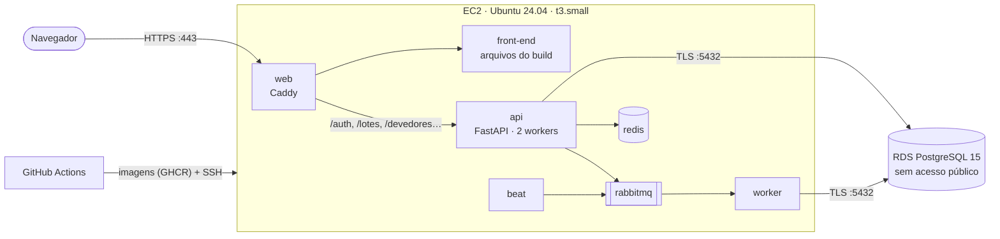

<div align="center">

# Deploy

**Produção na AWS: EC2 com Docker Compose, RDS PostgreSQL e entrega contínua pelo GitHub Actions**


<sub>[README](../README.md) · [RFC](../docs/RFC.md) · [Back-end](../back-end/DOC.md) · [Front-end](../front-end/README.md) · **Deploy** · [Registro do deploy](../docs/DEPLOY.md)</sub>

</div>

Este é o **guia operacional**: como provisionar e operar a produção. As decisões e a justificativa de cada escolha estão em [`docs/DEPLOY.md`](../docs/DEPLOY.md).

## Arquitetura



- **Front e API no mesmo domínio, sem prefixo.** O Caddy manda `/auth`, `/lotes`, `/devedores`, `/usuarios`, `/auditoria`, `/regras`, `/jobs`, `/dashboard` e `/health` para a API e o resto para o front. Assim o cookie de refresh (`path=/auth`) funciona, `COOKIE_SAMESITE=lax` basta e não há CORS entre origens. `/docs`, `/openapi.json` e `/metrics` **não** ficam públicos.
- **HTTPS automático:** o Caddy obtém e renova o certificado do Let's Encrypt para o `DOMINIO`.
- **Redis e RabbitMQ** rodam em contêiner na própria EC2 (ElastiCache e Amazon MQ custariam bem mais sem ganho para o volume do TCC).
- **Imagens** construídas pelo CI e publicadas no GitHub Container Registry (`ghcr.io/marielev/cobranca-api` e `cobranca-web`), com a tag do commit e `latest`. A EC2 só baixa e sobe.

| Arquivo | Para quê |
|---|---|
| `docker-compose.prod.yml` | Serviços de produção (o CI copia para `~/cobranca/docker-compose.yml` na EC2) |
| `.env.example` | Modelo do `~/cobranca/.env` da EC2 (segredos; nunca versionar) |
| `preparar-ec2.sh` | Instala Docker + Compose e cria swap na EC2 (roda uma vez) |

> [!WARNING]
> **Custos.** Crie um **alerta de orçamento antes** de criar os recursos (Billing → Budgets → *Customize* → *Cost budget*), com valor mensal (ex.: US$ 16) e alertas em 80% do gasto real e 100% do previsto.
>
> - Em **Budget scope → Advanced options → Charge types**, marque **Crédito excluído** (*Credit* desmarcado). Sem isso o orçamento desconta os créditos, o gasto aparece sempre como US$ 0 e o alerta nunca dispara. O *Zero spend budget* não serve para contas com créditos pelo mesmo motivo.
> - O RDS e o Elastic IP cobram mesmo com a EC2 parada. Quando os créditos ou o prazo deles acabam, o acesso aos serviços termina.

---

## 0. Antes de começar

1. **Conta AWS** com MFA no usuário root. Para o dia a dia, use um usuário IAM com MFA.
2. **Região `us-east-2` (Ohio)** para tudo (EC2, RDS, Elastic IP).
   - **Por quê:** EC2 e RDS custam bem menos em Ohio do que em São Paulo (`sa-east-1`), o que faz os créditos durarem mais.
   - **O que se perde:** latência maior para o Brasil (~120–150 ms por requisição, contra ~10–30 ms em São Paulo) e dados fora do país (LGPD, art. 33). O TCC usa só **dados fictícios**; em produção real, recrie os recursos em `sa-east-1` (nada no código depende da região).
3. **Domínio** apontando para a EC2 (o Let's Encrypt não emite para o IP padrão da AWS):
   - Grátis: [DuckDNS](https://www.duckdns.org), por exemplo `cobranca-tcc.duckdns.org` (o IP você preenche no passo 3). Deixe o campo **IPv6 vazio**: a EC2 não tem IPv6 e, com um registro AAAA, o Let's Encrypt tenta validar por ele e o certificado falha.
   - Domínio próprio (Registro.br, Route 53…): um registro **A** para o Elastic IP.

## 1. Rede (security groups)

Console **EC2 → Security Groups → Create**:

| Grupo | Entrada | Observação |
|---|---|---|
| `cobranca-ec2` | HTTP 80 · `0.0.0.0/0` | O Let's Encrypt valida por aqui; o Caddy redireciona para HTTPS |
| | HTTPS 443 · `0.0.0.0/0` | |
| | SSH 22 · `0.0.0.0/0` | O CI do GitHub não tem IP fixo; a proteção é a chave SSH (sem senha) |
| `cobranca-rds` | PostgreSQL 5432 · origem **o security group `cobranca-ec2`** | Não um IP: só a EC2 alcança o banco |

## 2. Banco: RDS PostgreSQL

Console **RDS → Create database**:

| Campo | Valor |
|---|---|
| Método | Standard create |
| Engine | PostgreSQL **15** (mesma versão do CI; em produção, 15.19) |
| Template | Free tier (ou Dev/Test) |
| Identificador | `cobranca-db` |
| Usuário master | `cobranca_app` · senha forte (sem `@ : / ? #`, para não precisar codificar na URL) |
| Classe | `db.t4g.micro` |
| Storage | gp3, 20 GB, autoscaling desligado |
| Conectividade | VPC padrão · **Public access: No** · security group `cobranca-rds` (remova o `default`) |
| Additional configuration | Initial database name `cobranca_db` · backups automáticos **1 dia** · encryption ligada · parâmetros `default.postgres15` |

Anote o **Endpoint** (ex.: `cobranca-db.xxxx.us-east-2.rds.amazonaws.com`). O PostgreSQL 15 do RDS já exige TLS, e a API se recusa a subir sem `?sslmode=require`.

> [!IMPORTANT]
> No plano gratuito, o RDS recusa retenção de backup maior que **1 dia** (o erro só aparece ao clicar em *Create database*). Antes de qualquer mudança arriscada (migração nova, véspera da banca), tire um **snapshot manual** (RDS → Ações → Tirar snapshot): ele não expira.

## 3. Servidor: EC2

Console **EC2 → Launch instance**:

| Campo | Valor |
|---|---|
| Nome | `cobranca` |
| AMI | **Ubuntu Server 24.04 LTS** (x86_64) |
| Tipo | **t3.small** (2 GB; a t3.micro, com 1 GB, não aguenta RabbitMQ + Celery + API) |
| Advanced → Credit specification | **Standard (Padrão)**: sem cobrança extra por CPU; a CPU só fica mais lenta quando os créditos de CPU acabam (atenção em testes de carga). No *Unlimited* a AWS cobra à parte. |
| Key pair | Create new → `cobranca-ec2`, tipo ED25519, formato `.pem` → **guarde o arquivo** |
| Rede | VPC padrão · Auto-assign public IP: Enable · security group `cobranca-ec2` |
| Storage | 20 GB gp3 |
| Advanced → User data | (opcional) o conteúdo de `preparar-ec2.sh` |

Depois:

1. **Elastic IP** (EC2 → Elastic IPs → Allocate → Associate à instância `cobranca`), para o IP não mudar quando a instância reinicia.
2. Aponte o domínio para o Elastic IP (no DuckDNS: cole o IP em *current ip* e *update ip*).
3. Conecte (PowerShell, na pasta do `.pem`):

   ```powershell
   icacls .\cobranca-ec2.pem /inheritance:r /grant:r "$($env:USERNAME):(R)"
   ssh -o ServerAliveInterval=60 -i .\cobranca-ec2.pem ubuntu@SEU_ELASTIC_IP
   ```

   Sem o `ServerAliveInterval`, a conexão cai quando fica alguns minutos ociosa. Depois que o domínio apontar para a EC2, use o domínio no lugar do IP. Guarde o `.pem` em `$env:USERPROFILE\.ssh\`, fora do repositório.

4. Se não usou o *User data*, rode a preparação (PowerShell, na raiz do repositório):

   ```powershell
   scp -i .\cobranca-ec2.pem deploy\preparar-ec2.sh ubuntu@SEU_ELASTIC_IP:~
   ssh -i .\cobranca-ec2.pem ubuntu@SEU_ELASTIC_IP "sudo bash preparar-ec2.sh"
   ```

   Saia, entre de novo e confira: `docker compose version`.

## 4. Segredos na EC2 (`~/cobranca/.env`)

No seu PC, gere os valores (no venv do back-end):

```powershell
python -c "import secrets; print(secrets.token_urlsafe(48))"                               # JWT_SECRET
python -c "from cryptography.fernet import Fernet; print(Fernet.generate_key().decode())"  # ENCRYPTION_KEY
python -c "import secrets; print(secrets.token_urlsafe(24))"                               # RABBITMQ_PASSWORD e ADMIN_SENHA_INICIAL
```

> [!CAUTION]
> A **`ENCRYPTION_KEY`** cifra o valor das dívidas no banco: perdê-la é perder esses dados. Guarde uma cópia num gerenciador de senhas e não reaproveite as chaves do `.env` de desenvolvimento.

Copie o modelo e edite **na EC2**:

```powershell
scp -i .\cobranca-ec2.pem deploy\.env.example ubuntu@SEU_ELASTIC_IP:cobranca/.env
ssh -i .\cobranca-ec2.pem ubuntu@SEU_ELASTIC_IP
```

```bash
cd ~/cobranca
chmod 600 .env
nano .env   # DOMINIO, DATABASE_URL (endpoint + senha do RDS), CORS_ORIGINS=https://DOMINIO, segredos, ADMIN_SENHA_INICIAL
```

A `ADMIN_SENHA_INICIAL` precisa de 8+ caracteres com letra e número e não pode ser `admin123` (o seed recusa em produção). Para conferir o `.env` sem expor valores: `sed -E 's/=.+/=***/' .env`.

## 5. GitHub: ambiente `producao`, segredos e pacotes

1. **Settings → Environments → `producao`** (usado pelo job Deploy): *Required reviewers* = você (cada deploy pede aprovação) e *Deployment branches* = só `main`.
2. Em **`producao` → Environment secrets**:

   | Segredo | Valor |
   |---|---|
   | `EC2_HOST` | o domínio (ex.: `cobranca-tcc.duckdns.org`) ou o Elastic IP |
   | `EC2_USUARIO` | `ubuntu` |
   | `EC2_CHAVE_SSH` | o conteúdo **inteiro** do `cobranca-ec2.pem` (com as linhas `-----BEGIN/END`) |
   | `EC2_KNOWN_HOSTS` | a linha da chave do servidor para o mesmo nome do `EC2_HOST` (veja abaixo) |

   Em **Environment variables**: `DOMINIO` = o seu domínio. Use o **mesmo nome** no `EC2_HOST` e no `EC2_KNOWN_HOSTS` (IP com IP, domínio com domínio), senão a verificação da chave do servidor falha.

   <details>
   <summary><b>Como obter o <code>EC2_KNOWN_HOSTS</code> no Windows</b></summary>
   <br/>

   O `ssh-keyscan` do Windows falha com `choose_kex: unsupported KEX method sntrup761x25519-sha512@openssh.com` (o OpenSSH do Windows é mais antigo que o do Ubuntu 24.04). Use uma destas opções:

   - **Do seu PC:** depois de conectar uma vez por SSH usando o domínio, copie a linha correspondente de `$env:USERPROFILE\.ssh\known_hosts` (a que começa com `cobranca-tcc.duckdns.org ssh-ed25519`).
   - **Na própria EC2:** `ssh-keyscan -t ed25519 cobranca-tcc.duckdns.org` e copie a linha que **não** começa com `#`.

   </details>

3. **Pacotes do GHCR:** publicados pelo workflow de um repositório público, `cobranca-api` e `cobranca-web` **herdam a visibilidade pública**, e a EC2 baixa sem login. Se o repositório ficar privado, torne os pacotes públicos (perfil → **Packages** → *Package settings* → *Change visibility*) ou faça `docker login ghcr.io` na EC2 com um token só com `read:packages`.

## 6. Primeiro deploy

1. Faça o merge na `main` (PR `develop` → `main`). Com os quatro checks aprovados, o job **Deploy** fica em **Aguardando**: clique em **Revisar implantações → Aprovar e implantar**. Ele então:
   1. constrói e publica as duas imagens no GHCR;
   2. copia o `docker-compose.prod.yml` para a EC2;
   3. roda `docker compose pull` + `up -d --wait` (a API aplica as migrações no RDS ao subir);
   4. testa `https://DOMINIO/health`.
2. Se o passo 3 falhar com erro de permissão no `pull`, confira a visibilidade dos pacotes (5.3) e clique em **Re-run failed jobs**.
3. Crie o administrador (uma vez):

   ```bash
   cd ~/cobranca
   docker compose exec api python -m app.seed
   ```

4. Abra `https://SEU_DOMINIO`, entre com `ADMIN_EMAIL` / `ADMIN_SENHA_INICIAL` e **troque a senha** em *Minha conta*.

---

## Operação

```bash
cd ~/cobranca
docker compose ps                              # estado dos serviços
docker compose logs -f --tail=100 api          # logs (api, worker, beat, web…)
docker compose restart worker                  # reiniciar um serviço
IMAGE_TAG=<sha-antigo> docker compose up -d    # voltar para a versão de um commit anterior
docker stats --no-stream                       # memória e CPU por contêiner
```

| Tarefa | Como |
|---|---|
| Atualizar segredos | Edite `~/cobranca/.env` e rode `docker compose up -d` (recria só o que mudou) |
| Testar um provedor | `docker compose exec api python -m app.testar_provedores email voce@exemplo.com` (uma mensagem, sem tocar no banco e sem desligar o modo simulado) |
| Ligar o envio real | `ENVIO_SIMULADO=false` e `ENVIO_REAL_CANAIS` só com os canais que têm chaves (ex.: `email`), depois `docker compose up -d`. **Só com uma base controlada**: com os e-mails fictícios dos testes, tudo volta como bounce e o SendGrid pode suspender a conta. Ver "Demonstração com envio real", abaixo |
| Backup | Automático diário (retenção de 1 dia); snapshot manual antes de algo arriscado |
| Créditos | Conferir o saldo no Faturamento uma vez por semana |
| Memória no limite | Reduza `--workers` da API ou `--concurrency` do worker no `docker-compose.prod.yml`, ou suba para `t3.medium` |
| Pausar para não gastar | Pare a EC2 e o RDS (o RDS religa sozinho após 7 dias) |
| Encerrar de vez | Apague a EC2 e o RDS (snapshot final, se quiser) e **libere o Elastic IP** |

> [!NOTE]
> Nos logs, `127.0.0.1 … GET /health` a cada poucos segundos é o *healthcheck* do Docker, e um `POST /auth/refresh 401` isolado é alguém abrindo o site sem sessão. Os dois são normais.

<details>
<summary><b>Diagnóstico: o site não abre</b></summary>
<br/>

1. **A instância está ligada?** Console AWS → EC2 → Instâncias → `cobranca` deve estar *Em execução* (e o RDS *Disponível*). Se os créditos acabaram, a conta pode ter sido suspensa: veja o Faturamento.
2. **O domínio aponta para o Elastic IP?** `nslookup cobranca-tcc.duckdns.org` deve devolver o Elastic IP; confira no painel do DuckDNS.
3. **Os contêineres estão saudáveis?** Por SSH: `cd ~/cobranca && docker compose ps`. Algum parado → `docker compose up -d` e `docker compose logs --tail=100 <serviço>`.
4. **O certificado foi emitido?** `docker compose logs web | grep -i -E "certificate|acme|error"`. Falhas de ACME costumam ser IPv6 preenchido no DuckDNS ou a porta 80 fechada no security group.
5. **A API responde por dentro?** `docker compose exec api python -c "import urllib.request; print(urllib.request.urlopen('http://localhost:8000/health').read())"`.

</details>

<details>
<summary><b>Demonstração com envio real (e-mail)</b></summary>
<br/>

Num dia útil, entre 8h e 19h55 (Brasília), fora de feriado. SMS e WhatsApp continuam simulados.

1. **Snapshot do RDS** (RDS → `cobranca-db` → Ações → Tirar snapshot).
2. **Escolha um atraso que ninguém da base tem** (ex.: 37 dias) e calcule o vencimento: dia da demo − 37 dias.
3. **Importe um lote** só com pessoas que aceitaram receber (o seu e-mail, colegas), com esse vencimento. O modo ainda é simulado.
4. **Na Régua:** desative as **outras regras de e-mail** e crie a regra da demo (e-mail, 37 dias, horário 08:00). **Não a ative ainda**: se ela rodar no modo simulado, o envio simulado conta como sucesso do dia (RN03) e o real não sai mais.
5. **Confira os elegíveis** da regra da demo: só podem aparecer as pessoas do lote.
6. **Ligue o envio real** por SSH: no `~/cobranca/.env`, `ENVIO_SIMULADO=false` e `ENVIO_REAL_CANAIS=email`; depois `docker compose up -d` e `docker compose ps` (todos *healthy*).
7. **Ative a regra da demo.** O beat dispara em até 5 minutos. Acompanhe em Monitoramento (job e comunicações) e no SendGrid → Activity.
8. **Depois da demo:** desative a regra, volte a `ENVIO_SIMULADO=true` e rode `docker compose up -d`.

</details>

---

## Testar a imagem do front localmente (opcional)

Com o back-end de desenvolvimento rodando (`docker compose up -d` em `back-end/`):

```powershell
docker build -t cobranca-web:teste front-end
docker run --rm --name web_teste --network back-end_default -e DOMINIO=localhost -p 8444:443 cobranca-web:teste
```

Abra <https://localhost:8444> (o navegador avisa do certificado local; aceite). Login, refresh e upload passam pelo Caddy exatamente como em produção.
