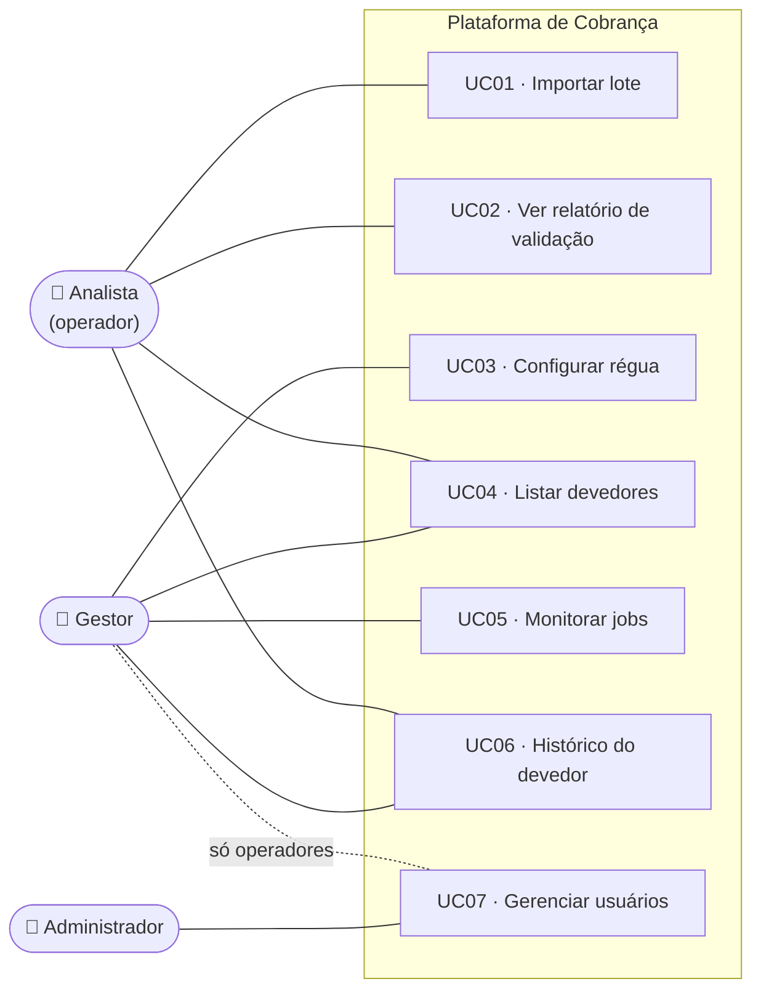
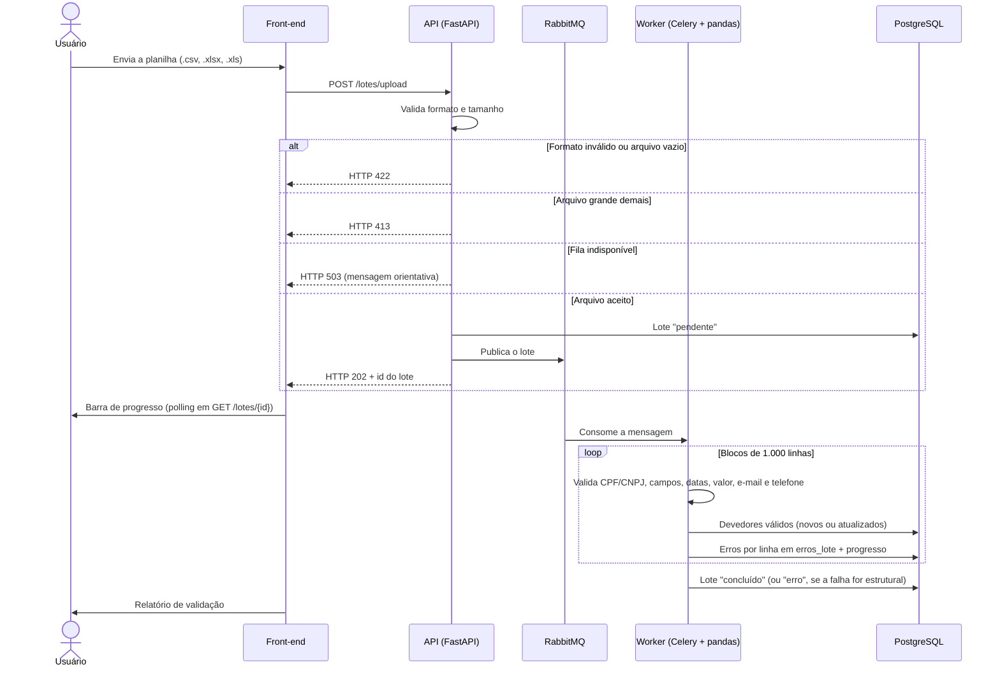
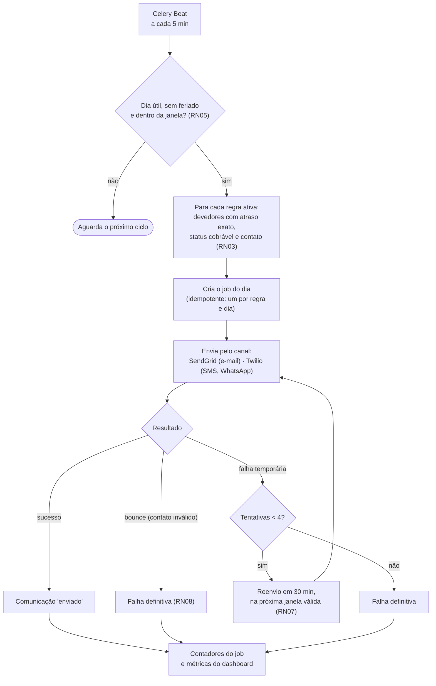
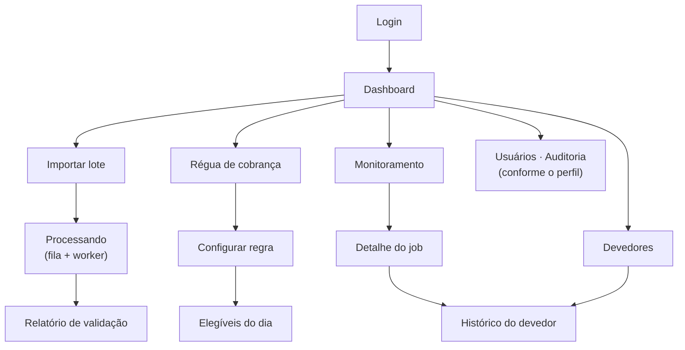
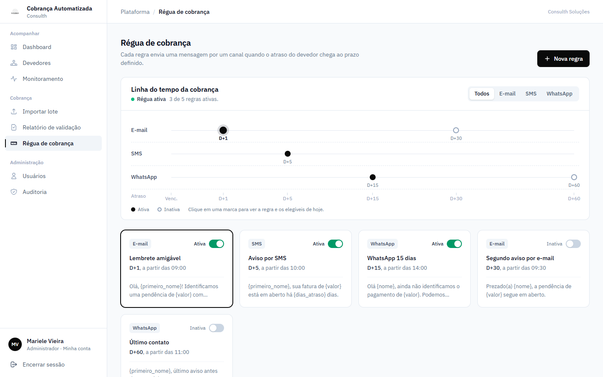
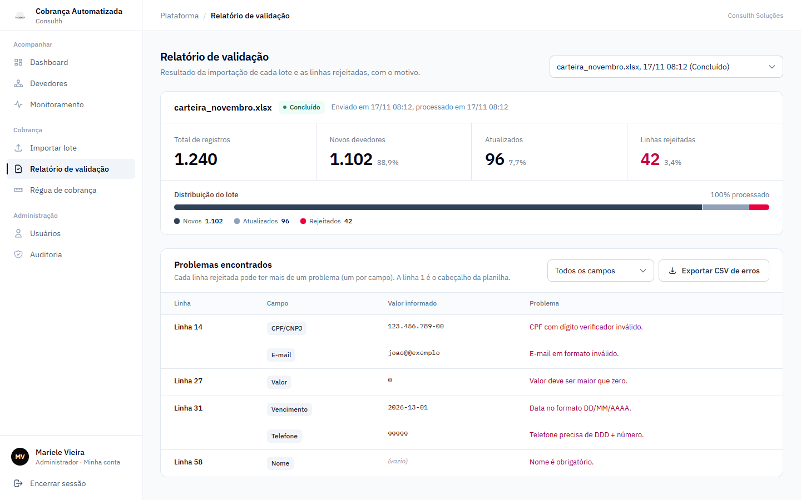
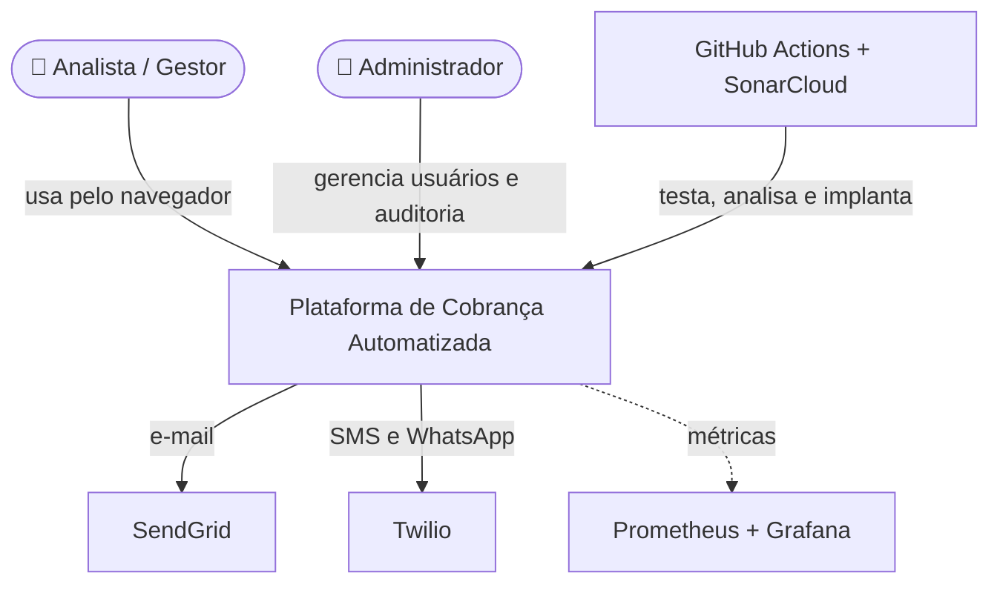
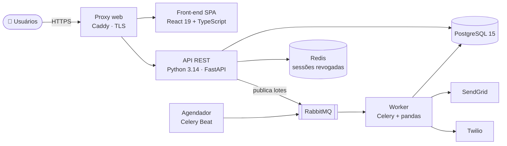
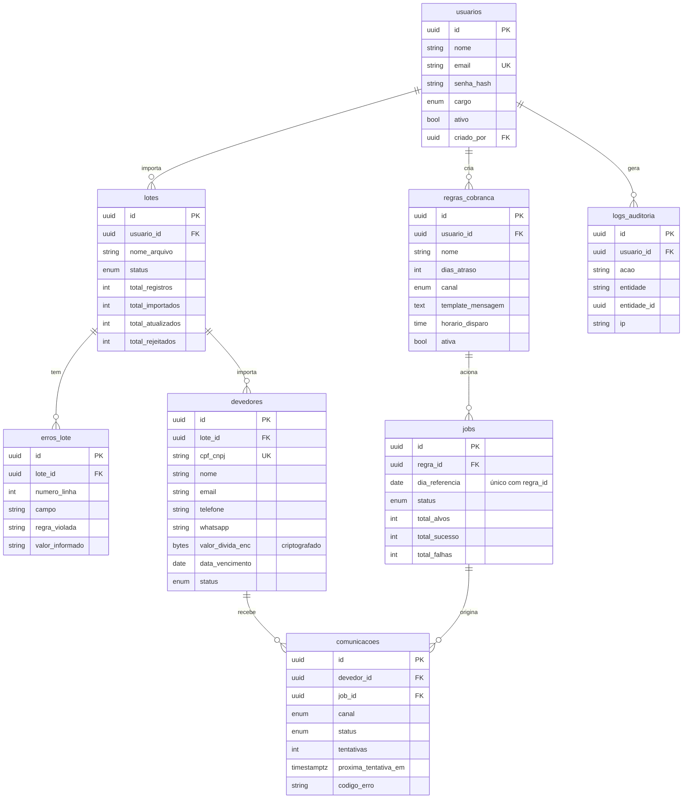

# RFC · Plataforma de Cobrança Automatizada

**Proposta técnica e especificação de requisitos**

[README](../README.md) · **RFC** · [Back-end](../back-end/DOC.md) · [Front-end](../front-end/README.md) · [Deploy](../deploy/README.md) · [Registro do deploy](./DEPLOY.md)

| | |
|---|---|
| **Autora** | Mariele Vieira da Silva |
| **Curso** | Engenharia de Software · Católica SC |
| **Empresa parceira** | Consulth Soluções Empresariais |
| **Proposta original** | v1.0, 12/04/2026 |
| **Versão atual** | v1.2, 17/11/2026 (documento único, consolidado) |

> [!NOTE]
> Este é o único documento de requisitos do projeto. A v1.2 reúne a proposta original (v1.0), a revisão de escopo (v1.1) e o que mudou durante a implementação ([seção 8](#8-implementação-e-desvios)). As versões anteriores continuam no histórico do Git.

---

## Sumário

1. [Visão do produto e impacto](#1-visão-do-produto-e-impacto)
2. [Engenharia de requisitos](#2-engenharia-de-requisitos)
3. [Fluxos e comportamento do sistema](#3-fluxos-e-comportamento-do-sistema)
4. [Experiência do usuário](#4-experiência-do-usuário)
5. [Arquitetura do sistema](#5-arquitetura-do-sistema)
6. [Segurança e privacidade](#6-segurança-e-privacidade)
7. [Planejamento](#7-planejamento)
8. [Implementação e desvios](#8-implementação-e-desvios)
9. [Referências](#9-referências)
10. [Parecer do comitê de avaliação](#10-parecer-do-comitê-de-avaliação)

<b>Histórico de versões</b>

 

| Versão | Data | Alterações |
|---|---|---|
| **1.0** | 12/04/2026 | Proposta original: problema, requisitos, fluxos, mockups, C4 e planejamento. |
| **1.1** | 06/11/2026 | Gestor passa a gerenciar **operadores** (RN06/UC07); formatos `.csv`, `.xlsx` e `.xls`; **WhatsApp** como terceiro canal; reenvio padronizado (RN07/RN08); modelo de dados em português, `snake_case`; Python 3.14; casos de uso renumerados. |
| **1.2** | 17/11/2026 | Documento único: diagramas da v1.0 trazidos para cá e atualizados (casos de uso, fluxos, navegação, C4, modelo de dados); stack e arquitetura de produção como implementadas; seção de desvios; RF05 concluído (filtro por canal). |

---

## 1. Visão do produto e impacto

### 1.1 Contexto e problema

A inadimplência é um desafio estrutural para empresas de diversos segmentos no Brasil. Segundo dados do Serasa Experian, o país ultrapassa 70 milhões de pessoas físicas inadimplentes, e empresas de médio porte perdem, em média, entre 3% e 8% da receita bruta anual em decorrência de cobranças mal executadas ou não realizadas.

O processo tradicional é majoritariamente manual: analistas exportam planilhas do ERP (*Enterprise Resource Planning*), filtram devedores manualmente, enviam e-mails individualmente e registram os contatos em outros sistemas. Limitações críticas:

- Alto custo operacional com tarefas repetitivas e de baixo valor.
- Inconsistência na régua de comunicação: cada analista aplica regras diferentes.
- Ausência de rastreabilidade e auditoria das ações realizadas.
- Impossibilidade de escalar o volume de cobranças sem aumentar o quadro de funcionários.
- Dados de retorno (pagamentos, negociações) não realimentam o sistema de forma automatizada.

Este projeto propõe uma plataforma web integrada que automatiza a ingestão de dados de inadimplentes, aplica regras de cobrança configuráveis e executa disparos multicanal (e-mail, SMS e WhatsApp) de forma programada e monitorada.

### 1.2 Origem da demanda e evidências

Foram realizadas entrevistas exploratórias com 5 profissionais da área financeira e 15 da área de cobrança da empresa parceira. Principais resultados:

| Achado | Resultado |
|---|:---:|
| Relatam que o envio de comunicações de cobrança é manual | **100%** |
| Não têm rastreabilidade sobre quais devedores receberam qual comunicação | **80%** |
| Apontam dificuldade de manter uma régua padronizada entre analistas | **100%** |

A empresa não usa solução dedicada: combina planilhas Excel, e-mail corporativo e sistemas legados.

### 1.3 Análise de soluções existentes

| Solução | Público-alvo | Pontos fortes | Limitações |
|---|---|---|---|
| Receita Certa | PMEs | Interface amigável, integração com Pix | Sem customização de régua, sem importação por CSV |
| Assertiva Cobranças | Médio porte | Automação básica de comunicação | Custo elevado, sem observabilidade |
| Iugu / Vindi | E-commerce e SaaS | Plataforma de pagamentos robusta | Foco em recorrência, não em carteira |
| Planilha + disparador de e-mail | Qualquer empresa | Baixo custo, familiar | Sem automação, rastreabilidade ou escala |

> [!IMPORTANT]
> **Diferencial.** Nenhuma das soluções oferece, ao mesmo tempo: (1) importação flexível de lotes via CSV/Excel com validação automatizada; (2) configuração visual da régua por perfil de devedor; (3) jobs programados com monitoramento em tempo real, em arquitetura moderna, aberta e auditável.

### 1.4 Público-alvo

Empresas de médio porte (cooperativas, varejistas, clínicas e prestadoras de serviço) que gerenciam internamente suas carteiras de inadimplentes.

- **Usuário primário:** analista de cobrança (nível intermediário de conhecimento tecnológico, uso via navegador).
- **Perfil secundário:** gestor financeiro, que acessa dashboards e configura a régua.

O projeto é desenvolvido em parceria com a **Consulth Soluções Empresariais** (CNPJ 33.536.315/0001-07), especializada em recuperação de crédito e cobrança B2B.

### 1.5 Objetivos

**Geral:** desenvolver uma plataforma web para automação do ciclo de cobrança, da ingestão e validação de dados ao disparo multicanal e monitoramento dos resultados, com foco em qualidade, segurança e observabilidade.

**Específicos:**

- Pipeline assíncrono de ingestão e validação de arquivos CSV/Excel com feedback de erros por linha.
- Módulo visual de configuração da régua, com canais e prazos por perfil de devedor.
- Jobs de disparo (e-mail, SMS e WhatsApp) com agendamento configurável.
- Dashboard com métricas de execução, taxa de entrega e taxa de conversão.
- Qualidade de código com TDD, CI/CD automatizado e análise estática via SonarCloud.

### 1.6 Métricas de sucesso

| KPI | Meta | Como é verificado |
|---|---|---|
| Tempo de resposta da API (P95) | < 300 ms | Teste de carga com k6 ([`carga/`](../carga/README.md)) |
| Throughput de processamento de lote | > 10.000 registros/min | Lote de 50.000 registros (RNF03) |
| Cobertura de testes (back-end) | ≥ 80% | pytest no CI (hoje ~97%) |
| Cobertura de testes (front-end) | ≥ 25% | Vitest no CI (exigido 80%; hoje ~91% na lógica) |
| Disponibilidade do serviço | ≥ 99% | Teste de `/health` a cada deploy |
| Taxa de sucesso nos disparos de e-mail | > 95% | Meta exibida no dashboard |
| Quality Gate SonarCloud | Aprovado | Check obrigatório no merge para a `main` |

---

## 2. Engenharia de requisitos

### 2.1 Personas

<table>
<tr>
<td width="50%" valign="top">

**Heloizi Vargas** · Analista de Cobrança

Trabalha em uma cooperativa de crédito e cobrança e gerencia uma carteira de 2.000 devedores por mês.

- **Objetivo:** enviar cobranças sem fazê-lo manualmente, uma a uma.
- **Dores:** perde horas exportando planilhas do ERP e enviando e-mails; erra ao filtrar devedores por prazo, gerando cobrança indevida com risco de processos.

</td>
<td width="50%" valign="top">

**Fellipe Junkes** · Gestor Financeiro

Responsável pela estratégia de recuperação de crédito B2B.

- **Objetivo:** acompanhar em tempo real o desempenho das campanhas e ajustar a régua conforme o perfil dos devedores.
- **Dores:** sem visibilidade sobre as ações tomadas e sem como mensurar o retorno das comunicações.

</td>
</tr>
</table>

### 2.2 Casos de uso

| Código | Caso de uso | Atores |
|---|---|---|
| UC01 | Importar lote de devedores (CSV/XLSX/XLS) | Analista |
| UC02 | Visualizar relatório de validação do lote | Analista |
| UC03 | Configurar régua de cobrança (canal, prazo, mensagem) | Gestor |
| UC04 | Visualizar lista de devedores e status de comunicação | Analista, Gestor |
| UC05 | Monitorar execução dos jobs de disparo em tempo real | Gestor |
| UC06 | Consultar histórico de comunicações por devedor | Analista, Gestor |
| UC07 | Gerenciar usuários e permissões de acesso | Gestor (escopo limitado), Administrador |

<b>UC07: escopo do gestor e do administrador</b>

 

**Gestor (somente perfil operador)**

| Ação | Descrição |
|---|---|
| G1 | Criar/editar usuários operadores |
| G2 | Redefinir senha de operador |
| G3 | Ativar/desativar operador |
| G4 | Visualizar lista de usuários |

O gestor **não** cria, edita nem promove gestores ou administradores.

**Administrador (acesso total)**

| Ação | Descrição |
|---|---|
| A1 | Criar/editar qualquer usuário |
| A2 | Definir/alterar perfil de acesso |
| A3 | Redefinir senha de qualquer usuário |
| A4 | Ativar/desativar/excluir usuário |
| A5 | Visualizar log de auditoria (**exclusivo**) |
| A6 | Visualizar lista completa de usuários |

### 2.3 Requisitos funcionais

| ID | Requisito | Situação |
|---|---|:---:|
| **RF01** | Permitir upload de arquivos CSV e Excel (`.xlsx` e `.xls`) com dados de devedores. | ✅ |
| **RF02** | Processar o arquivo de forma assíncrona e exibir o progresso em tempo real. | ✅ |
| **RF03** | Validar cada linha conforme as regras de negócio e exibir relatório detalhado de erros por linha, com download em CSV. | ✅ |
| **RF04** | Permitir configurar a régua de cobrança: canais (e-mail, SMS, WhatsApp), prazo de atraso, horário e template de mensagem. | ✅ |
| **RF05** | Listar devedores com filtros por status, prazo e canal. | ✅ |
| **RF06** | Executar jobs programados que disparam comunicações aos devedores elegíveis conforme a régua ativa. | ✅ |
| **RF07** | Registrar o resultado de cada tentativa de disparo (sucesso, falha, bounce), com número da tentativa e código de erro. | ✅ |
| **RF08** | Exibir dashboard com total de disparos, taxa de entrega e taxa de conversão. | ✅ |
| **RF09** | Autenticar usuários com controle de perfis (operador, gestor, administrador). | ✅ |
| **RF10** | Permitir o gerenciamento de usuários e permissões, conforme o escopo de cada perfil (UC07). | ✅ |
| **RF11** | Permitir ao administrador consultar o log de auditoria de acessos e ações. | ✅ |
| **RF12** | Disponibilizar endpoint de exclusão de todos os dados de um devedor (LGPD, art. 18). | ✅ |

### 2.4 Requisitos não funcionais

| ID | Requisito | Situação |
|---|---|:---:|
| **RNF01** | Suportar ao menos 100 usuários simultâneos sem degradação. | ✅ 100 usuários com 0% de falhas ([resultados](../carga/README.md#resultados)) |
| **RNF02** | Tempo de resposta das rotas de API < 300 ms no P95. | ✅ P95 de 99 ms com 100 usuários ([resultados](../carga/README.md#resultados)) |
| **RNF03** | Processar arquivos de até 50.000 registros. | ✅ limite aplicado; 🧪 evidência em [`carga/`](../carga/README.md) |
| **RNF04** | Autenticação JWT com tokens de curta duração e refresh token. | ✅ |
| **RNF05** | Dados sensíveis armazenados com criptografia em repouso. | ✅ |
| **RNF06** | Cobertura mínima de 80% nos testes do backend (pytest). | ✅ ~97% |
| **RNF07** | O CI/CD deve bloquear o deploy se os testes falharem ou o Quality Gate do SonarCloud não for aprovado. | ✅ |
| **RNF08** | Expor métricas no formato Prometheus para Grafana. | ✅ |
| **RNF09** | Todos os serviços conteinerizados com Docker e orquestrados via Docker Compose. | ✅ |

### 2.5 Regras de negócio

| ID | Regra |
|---|---|
| **RN01** | Somente usuários autenticados com perfil de operador ou superior podem importar lotes. |
| **RN02** | A régua só pode ser ativada após ao menos uma regra válida estar configurada. |
| **RN03** | Um devedor não pode receber mais de uma comunicação **bem-sucedida** do mesmo canal no mesmo dia. Tentativas com falha não contam para o limite, permitindo o reenvio. |
| **RN04** | Linhas com CPF/CNPJ inválido são rejeitadas e não ingressam na base. |
| **RN05** | Jobs de disparo executam apenas em dias úteis, entre 08h00 e 20h00 (horário de Brasília). Reenvios fora da janela são reagendados para a próxima janela válida. |
| **RN06** | O administrador pode criar, editar, ativar/desativar, excluir e alterar o perfil de qualquer usuário. O gestor pode criar, editar, ativar/desativar e redefinir a senha **apenas de usuários com perfil operador**. O operador não gerencia usuários. O log de auditoria é exclusivo do administrador. |
| **RN07** | Cada comunicação admite 1 envio inicial e até 3 reenvios (máximo de 4 tentativas), com intervalo mínimo de 30 minutos (valores configuráveis por variável de ambiente). Esgotadas as tentativas, a falha é registrada como definitiva. |
| **RN08** | Bounce permanente (e-mail inexistente, número inválido) não é reenviado e é registrado como falha definitiva imediatamente. |

### 2.6 Fora do escopo

- Integração direta com sistemas de pagamento ou emissão de boletos.
- Portal de autoatendimento para o devedor final.
- Módulo de negociação ou parcelamento de dívidas.
- Importação por integração via API com ERPs externos.
- Canais de voz (ligações automatizadas).
- Aplicativo mobile.

---

## 3. Fluxos e comportamento do sistema

### 3.1 Fluxo principal: ingestão e validação de lotes

| Etapa | Ator | Descrição |
|:---:|---|---|
| 1 | Usuário | Acessa o portal e seleciona «Importar lote». |
| 2 | Usuário | Faz upload do arquivo (`.csv`, `.xlsx` ou `.xls`). |
| 3 | API | Valida o formato, registra o lote como `pendente` e publica mensagem na fila RabbitMQ. |
| 4 | Worker | Consome a mensagem e lê o arquivo com pandas (`xlrd` para `.xls`, `openpyxl` para `.xlsx`). |
| 5 | Worker | Valida CPF/CNPJ, campos obrigatórios, formatos de data, valor, e-mail e telefone. |
| 6 | Worker | Persiste registros válidos no PostgreSQL e erros em `erros_lote`. |
| 7 | Worker | Atualiza o status e os contadores do lote. |
| 8 | Front-end | Exibe o relatório: importados, atualizados, rejeitados e erros por linha. |

### 3.2 Fluxo secundário: execução da régua de cobrança

1. O agendador (Celery Beat) aciona o ciclo respeitando a **RN05**, incluindo feriados nacionais e os configurados.
2. O worker consulta os devedores elegíveis de cada regra ativa e aplica a **RN03**.
3. Para cada devedor elegível, chama o cliente do canal: e-mail (SendGrid), SMS ou WhatsApp (Twilio).
4. O resultado de cada chamada (sucesso, falha, bounce) é gravado em `comunicacoes`, com tentativa e código de erro.
5. Em falha temporária, o reenvio é agendado (**RN07**). Em bounce permanente, a falha é definitiva (**RN08**).
6. O job fica `executando` enquanto houver reenvio pendente e termina `concluido` ou `falhou`.

### 3.3 Fluxos alternativos e exceções

| Situação | Comportamento |
|---|---|
| Arquivo inválido | Formato fora de CSV/XLSX/XLS ou arquivo vazio retorna **HTTP 422** sem enfileirar; arquivo acima do limite, **HTTP 413**. |
| Falha estrutural | Arquivo ilegível ou sem coluna obrigatória: o lote termina com status `erro` e o motivo aparece no relatório. |
| Fila indisponível | A API retorna **HTTP 503** com mensagem orientativa. |
| Falha no disparo externo | Erro registrado com código; reenvio após 30 minutos, até 3 reenvios (RN07). |
| Sistema fora do ar no horário | O job daquele dia pode ser criado manualmente (`POST /regras/{id}/executar`), até 7 dias para trás. |
| Usuário não autenticado | Rota protegida retorna **HTTP 401**; o front tenta renovar a sessão uma vez e, se falhar, volta ao login. |
| Sem permissão | Ação fora do perfil retorna **HTTP 403** (por exemplo, gestor tentando criar outro gestor). |
| Conflito de regra | Ativar uma segunda regra para o mesmo canal e dia de atraso retorna **HTTP 409**. |

---

## 4. Experiência do usuário

### 4.1 Fluxo de navegação

Protótipo de baixa fidelidade no [Figma](https://www.figma.com/design/aTgE91sZyzbxTrB8kh5clh/Plataforma-de-Cobran%C3%A7a-Automatizada). A interface implementada evoluiu a partir dele (ver [seção 8](#8-implementação-e-desvios)).

### 4.2 Telas principais

| Tela | Conteúdo |
|---|---|
| **Login** | E-mail e senha, mensagens de erro claras e orientação para recuperar o acesso com o administrador. |
| **Dashboard** | Devedores na base, disparos do dia, taxa de entrega × meta, falhas, conversão, volume diário (7/15/30 dias), distribuição por canal, últimos lotes e jobs. |
| **Importar lote** | Área de arrastar e soltar (`.csv`, `.xlsx`, `.xls`, até 50.000 registros), colunas obrigatórias e opcionais, planilha modelo e progresso em etapas. |
| **Relatório de validação** | Totais (novos, atualizados, rejeitados), distribuição do lote, erros agrupados por linha (campo e regra violada) e exportação em CSV. |
| **Devedores** | Busca, filtros por status, atraso e canal, marcador visual do atraso e painel com dados, troca de status, histórico e exclusão (LGPD). |
| **Régua de cobrança** | Linha do tempo das regras por canal (D+N), cards com ativação, editor com variáveis e pré-visualização, elegíveis do dia e execução manual. |
| **Monitoramento** | Saúde dos serviços, janela de disparo, jobs com progresso e o resultado de cada comunicação. |
| **Usuários e auditoria** | Gestão conforme o perfil e trilha de auditoria filtrável (só administrador). |

Colunas da planilha: obrigatórias `cpf_cnpj`, `nome`, `email`, `valor_divida`, `data_vencimento`; opcionais `telefone`, `whatsapp`.

  
  

---

## 5. Arquitetura do sistema

### 5.1 Modelo C4

**Nível 1: contexto**

**Nível 2: containers**

| Container | Tecnologia | Responsabilidade |
|---|---|---|
| Proxy web | Caddy | HTTPS automático, arquivos do front-end e encaminhamento das rotas da API. |
| Front-end (SPA) | React 19 + Vite + TypeScript | Interface web; consome a API REST. |
| API | Python 3.14 + FastAPI | Rotas REST, autenticação, autorização e publicação de mensagens na fila. |
| Worker | Celery + pandas | Processa lotes e executa os disparos. |
| Agendador | Celery Beat | Aciona o ciclo da régua a cada 5 minutos. |
| Broker | RabbitMQ | Desacopla o upload do processamento, com filas duráveis. |
| Banco de dados | PostgreSQL 15 | Usuários, lotes, devedores, regras, jobs, comunicações e auditoria. |
| Cache | Redis | Sessões revogadas, limite de tentativas de login e resultados temporários. |

**Nível 3: componentes do back-end**

| Pacote | Conteúdo | Responsabilidade |
|---|---|---|
| `app/api` | `auth`, `lotes`, `devedores`, `regras`, `jobs`, `dashboard`, `usuarios`, `auditoria` | Rotas HTTP: validam a entrada (Pydantic), checam o perfil e delegam. |
| `app/services` | `regua`, `disparo`, `dashboard` | Regras de negócio: elegibilidade, criação de jobs, reenvios e indicadores. |
| `app/worker` | `tasks`, `disparo_tasks`, `validadores` | Tarefas Celery: importação de lotes e ciclo de disparo. |
| `app/clients` | `sendgrid`, `twilio`, `simulado` | Clientes dos provedores, com um simulado para desenvolvimento. |
| `app/core` | `security`, `crypto`, `feriados`, `janela`, `rate_limit`, `metricas`… | Infraestrutura transversal: autenticação, criptografia, calendário e métricas. |
| `app/models` · `app/schemas` | SQLAlchemy · Pydantic | Persistência e contratos da API. |

### 5.2 Modelo de dados

**Convenções:** nomes em português, `snake_case`, tabelas no plural, chaves primárias UUID, datas com fuso (`TIMESTAMPTZ`), migrações versionadas com Alembic.

| Tipo enumerado | Valores |
|---|---|
| `cargo_usuario` | `operador`, `gestor`, `administrador` |
| `canal_disparo` | `email`, `sms`, `whatsapp` |
| `status_lote` | `pendente`, `processando`, `concluido`, `erro` |
| `status_devedor` | `ativo`, `comunicado`, `negociando`, `quitado`, `inativo` |
| `status_job` | `agendado`, `executando`, `concluido`, `falhou` |
| `status_comunicacao` | `pendente`, `enviado`, `entregue`, `falha`, `bounce` |

**Decisões de modelagem:**

- O valor da dívida é criptografado em nível de aplicação, o que impede somas diretas em SQL; o dashboard trabalha com contagens e taxas.
- `data_vencimento` permanece em claro para permitir o cálculo de atraso com índice.
- Contadores em `lotes` e `jobs` evitam `COUNT(*)` pesado no dashboard.
- A restrição única (`regra_id`, `dia_referencia`) em `jobs` garante um job por regra e dia, mesmo com vários workers.
- `logs_auditoria` sustenta o UC07-A5 e o RF11.

### 5.3 Stack tecnológica

| Tecnologia | Uso | Justificativa |
|---|---|---|
| Python 3.14 + FastAPI | API e workers | Produtividade, tipagem com Pydantic e documentação OpenAPI automática. |
| SQLAlchemy 2 + Alembic | ORM e migrações | Consultas parametrizadas e esquema versionado. |
| React 19 + Vite + TypeScript | Front-end (SPA) | Biblioteca madura, build rápido e tipagem dos contratos da API. |
| Tailwind CSS v4 | Estilo | Sistema visual consistente sem CSS solto. |
| PostgreSQL 15 | Banco relacional | Robusto, transacional (ACID). |
| RabbitMQ | Broker de mensagens | Filas duráveis; protocolo AMQP amplamente suportado. |
| Redis | Cache e sessões | Alta performance em memória. |
| Celery + Celery Beat | Tarefas e agendamento | Execução assíncrona e agendamento recorrente. |
| pandas + openpyxl + xlrd | Leitura de planilhas | Suporte a `.csv`, `.xlsx` e `.xls`. |
| Docker + Docker Compose | Conteinerização | Ambiente reproduzível em desenvolvimento, CI e produção. |
| Caddy | Proxy e HTTPS | Certificados emitidos e renovados automaticamente. |
| GitHub Actions + SonarCloud | CI/CD e análise estática | Integração nativa com o GitHub; Quality Gate automatizado. |
| pytest · Vitest + Testing Library | Testes | Padrões dos ecossistemas Python e React/Vite. |
| Prometheus + Grafana | Observabilidade | Stack aberta de referência. |
| AWS (EC2 + RDS) | Hospedagem | Créditos acadêmicos; banco gerenciado com backup e criptografia. |

---

## 6. Segurança e privacidade

### 6.1 Controles de segurança

| Área | Controle |
|---|---|
| Autenticação | JWT com *access token* de 15 minutos e *refresh token* de 7 dias (com rotação) em cookies `httpOnly`, `Secure` e `SameSite=Lax`; revogação no logout, na troca de senha e na desativação da conta. |
| Autorização | RBAC com operador, gestor e administrador (RN06), verificado em cada rota. |
| OWASP Top 10 | Validação de entrada com Pydantic; ORM parametrizado contra SQL Injection; cabeçalhos HSTS, `X-Frame-Options`, `X-Content-Type-Options` e `Referrer-Policy`. |
| Força bruta | Limite de tentativas de login por IP e e-mail (HTTP 429). |
| Transporte | HTTPS obrigatório em produção (Caddy + Let's Encrypt); TLS obrigatório na conexão com o banco. |
| Senhas | Hash bcrypt com custo 12; 8 a 128 caracteres com letra e número. |
| Segredos | Fora do repositório (`.env` não versionado no servidor e segredos do ambiente de produção no GitHub). |
| Análise | SonarCloud com Quality Gate obrigatório no merge. |

### 6.2 Privacidade e LGPD

| Exigência | Implementação |
|---|---|
| Base legal | Os dados vêm das empresas parceiras (controladoras); a plataforma atua como operadora. |
| Proteção de dados | Valor da dívida criptografado em nível de aplicação; disco e banco criptografados em produção; CPF/CNPJ mascarado nas listas. |
| Direito de exclusão (art. 18) | Exclusão permanente de um devedor e de todo o seu histórico, restrita ao administrador e registrada na auditoria. |
| Auditoria | Registro das ações sensíveis com usuário, entidade, IP e data. |
| Compartilhamento | Apenas com os provedores de disparo (SendGrid e Twilio). |
| Transferência internacional (art. 33) | O ambiente do TCC fica nos EUA e usa somente dados fictícios; para uso real, a recomendação é a região de São Paulo ([`DEPLOY.md`](./DEPLOY.md#4-escolha-da-região-us-east-2-ohio)). |

---

## 7. Planejamento

```mermaid
gantt
    title Marcos do projeto (semanas)
    dateFormat X
    axisFormat %s
    section Base
    M1 · Setup e fundação           :done, m1, 0, 2
    M2 · Ingestão e validação       :done, m2, 2, 5
    section Régua
    M3 · Régua, devedores e RBAC    :done, m3, 5, 7
    M4 · Jobs e monitoramento       :done, m4, 7, 10
    section Entrega
    M5 · Qualidade e observabilidade :done, m5, 10, 12
    M6 · Deploy e documentação      :done, m6, 12, 14
```

| Marco | Descrição | Prazo | Situação |
|---|---|---|:---:|
| **M1** · Setup e fundação | Repositório, Docker Compose, base FastAPI e React, CI/CD inicial com GitHub Actions e SonarCloud. | Semanas 1–2 | ✅ |
| **M2** · Ingestão e validação | Upload (CSV/XLSX/XLS), RabbitMQ, worker com pandas, validações de negócio e relatório de erros. TDD nas regras de validação. | Semanas 3–5 | ✅ |
| **M3** · Régua de cobrança | CRUD de regras, interface de configuração, devedores e status, autenticação, RBAC e gestão de usuários. | Semanas 6–7 | ✅ |
| **M4** · Jobs e monitoramento | Celery Beat, integração com e-mail, SMS e WhatsApp, política de reenvio, dashboard e métricas Prometheus. | Semanas 8–10 | ✅ |
| **M5** · Qualidade e observabilidade | Metas de cobertura, Quality Gate e dashboards Grafana. | Semanas 11–12 | ✅ |
| **M6** · Deploy e documentação | Deploy com Docker e HTTPS, documentação final e apresentação. | Semanas 13–14 | ✅ |

---

## 8. Implementação e desvios

O sistema foi implementado conforme este documento, com as diferenças abaixo. Cada uma tem um motivo registrado.

### 8.1 Infraestrutura

| A proposta previa | O que foi feito | Por quê |
|---|---|---|
| Deploy em VPS com Docker (M6) | AWS: EC2 com Docker Compose + RDS para o banco | Créditos acadêmicos; banco gerenciado com backup e criptografia |
| TLS via Nginx | Caddy | Emite e renova o certificado HTTPS sozinho, com configuração bem menor |
| PostgreSQL em contêiner | RDS em produção (contêiner no desenvolvimento e no CI) | Dados persistentes num serviço gerenciado |
| AWS SES / SNS como alternativas | SendGrid (e-mail) e Twilio (SMS e WhatsApp) | Um provedor por canal, com cliente simulado para desenvolvimento |
| Testes de front-end com Jest | Vitest + Testing Library | Integração nativa com o Vite; mesma API do Jest |

Detalhes da produção em [`DEPLOY.md`](./DEPLOY.md).

### 8.2 Interface

| A proposta previa | O que foi feito | Por quê |
|---|---|---|
| Painel de "alertas" no dashboard | Distribuição por canal + taxa de conversão | Os alertas relevantes já aparecem nos indicadores e no monitoramento |
| "Último contato" e exportação CSV na lista de devedores | Coluna de canais possíveis; sem exportação | A exportação em arquivo solto de dados pessoais conflita com a LGPD |
| Log "estilo terminal" no monitoramento | Saúde dos serviços + janela de disparo + resultado de cada comunicação | Informação acionável no lugar de um log bruto |
| "Esqueceu a senha?" com recuperação por e-mail | "Fale com o administrador" | Não há envio de e-mail transacional de recuperação; o administrador redefine a senha |
| Métricas por regra nos cards da régua | Linha do tempo D+N e elegíveis do dia | Não há endpoint de métricas por regra |

### 8.3 Pendências conhecidas

- [ ] **Provedores reais:** validar SendGrid e Twilio com chaves reais (o sistema roda em modo simulado).
- [x] **RNF01/RNF02:** teste de carga executado em 23/11/2026 (100 usuários, P95 de 99 ms, 0% de falhas, ambiente local; [resultados](../carga/README.md#resultados)).
- [ ] **RNF03:** importar o lote de 50.000 registros e registrar o tempo de processamento ([`carga/`](../carga/README.md)).
- [ ] **Retenção da auditoria:** a proposta previa logs por 90 dias com anonimização posterior; hoje os registros são mantidos sem expurgo automático.
- [ ] **CSP e Dependabot:** o cabeçalho `Content-Security-Policy` e a atualização automática de dependências não foram configurados.
- [ ] **Status `entregue`:** depende de webhooks dos provedores; hoje "enviado" significa aceito pelo provedor.
- [ ] **WhatsApp em produção:** exige templates aprovados pela Meta para mensagens iniciadas pela empresa.

---

## 9. Referências

- [FastAPI](https://fastapi.tiangolo.com) · [Celery](https://docs.celeryq.dev) · [RabbitMQ](https://www.rabbitmq.com/documentation.html) · [PostgreSQL 15](https://www.postgresql.org/docs/15/)
- [Prometheus Python Client](https://github.com/prometheus/client_python) · [SonarCloud](https://docs.sonarcloud.io) · [GitHub Actions](https://docs.github.com/actions) · [Docker](https://docs.docker.com)
- [OWASP Top 10 (2021)](https://owasp.org/www-project-top-ten)
- [LGPD, Lei nº 13.709/2018](http://www.planalto.gov.br/ccivil_03/_ato2015-2018/2018/lei/l13709.htm)
- [C4 Model, Simon Brown](https://c4model.com)

---

## 10. Parecer do comitê de avaliação

> *A ser preenchido pelos professores avaliadores.*

| | Avaliador 1 | Avaliador 2 |
|---|---|---|
| **Nome** | | |
| **Situação** | ☐ Aprovado &nbsp; ☐ Ajustar | ☐ Aprovado &nbsp; ☐ Ajustar |
| **Observações** | | |

---

Plataforma de Cobrança Automatizada · Mariele Vieira da Silva · Engenharia de Software · Católica SC · 2026

