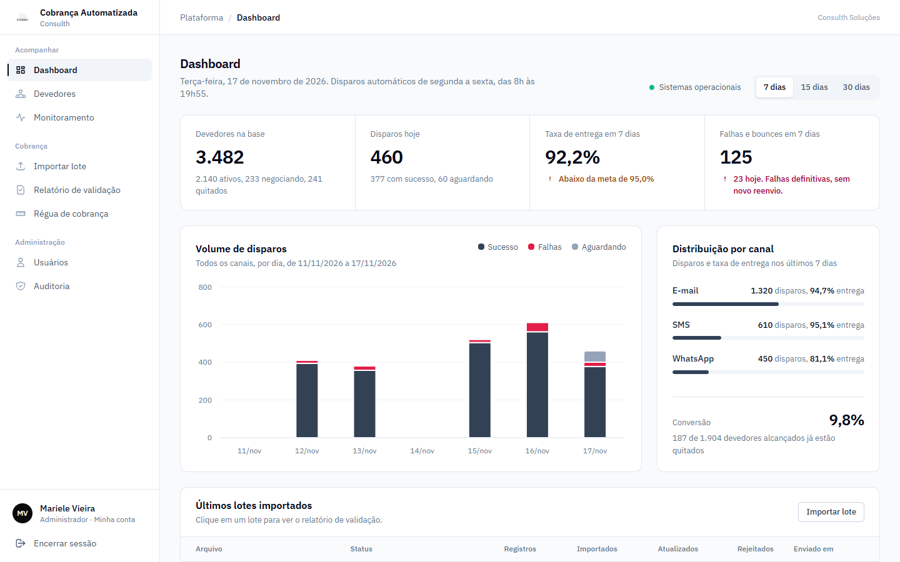
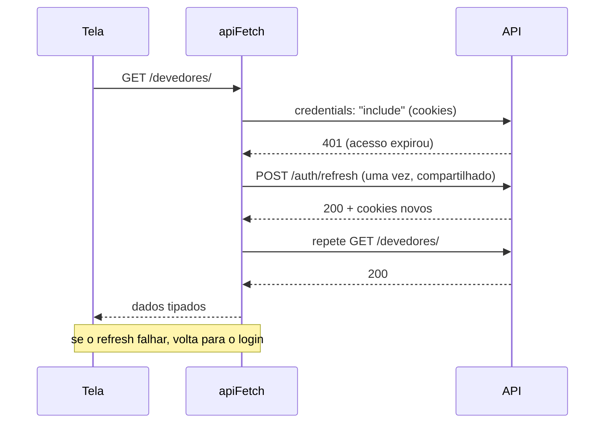
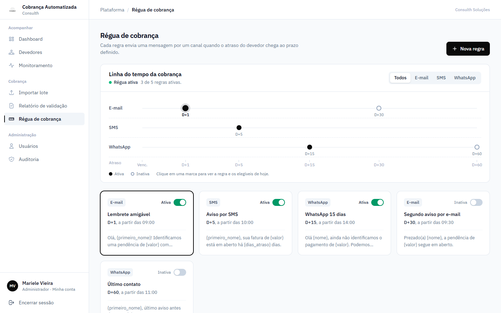
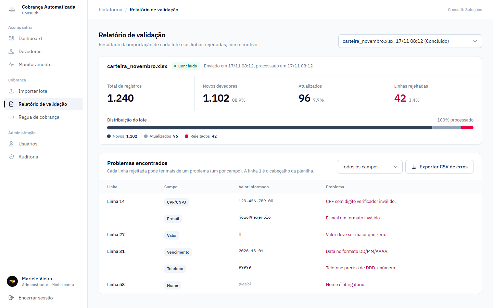

<div align="center">

# Front-end

**Painel web da plataforma: SPA em React com sessão por cookies e sistema visual próprio**


<sub>[README](../README.md) · [RFC](../docs/RFC.md) · [Back-end](../back-end/DOC.md) · **Front-end** · [Deploy](../deploy/README.md) · [Roteiro de testes](./ROTEIRO_TESTES.md)</sub>

<br/>



</div>

---

## Visão geral

Nove telas (login, dashboard, importação, relatório de validação, devedores, régua, monitoramento, usuários e auditoria) consumindo a API REST, com as permissões de cada perfil refletidas na interface.

| | |
|---|---|
| **Sem dependências desnecessárias** | `fetch` nativo, navegação por estado e Context API: só React, Tailwind e Recharts em produção |
| **Sessão segura** | O token nunca passa pelo JavaScript: cookies `httpOnly` gravados pelo back-end |
| **72 testes** | Vitest + Testing Library; ~91% de cobertura na lógica (`lib`, `hooks`, `auth`), mínimo de 80% no CI |
| **Sem avisos** | ESLint com `--max-warnings 0` e TypeScript estrito no CI |
| **Imagem de produção** | Build do Vite servido pelo Caddy (HTTPS e proxy da API no mesmo domínio) |

---

## Como executar

> [!IMPORTANT]
> Pré-requisitos: **Node.js 22 LTS** e o back-end no ar (`docker compose up -d --build` na pasta `back-end` e o seed aplicado). Veja o [README do back-end](../back-end/DOC.md#como-executar).

```powershell
cd front-end
Copy-Item .env.example .env     # primeira vez
npm install                     # primeira vez ou quando o package.json mudar
npm run dev                     # http://localhost:8443
```

Login de desenvolvimento: `admin@consulth.com.br` / `admin123`.

| Script | O que faz |
|---|---|
| `npm run dev` | Servidor de desenvolvimento na porta 8443, com *hot reload* |
| `npm run verificar` | **Tudo o que o CI roda:** lint, tipos, testes com cobertura e build |
| `npm run lint` | ESLint (TypeScript + regras de hooks); falha com qualquer aviso |
| `npm run typecheck` | Checagem de tipos, incluindo os testes |
| `npm test` · `npm run test:watch` | Testes uma vez · em modo observação |
| `npm run test:coverage` | Testes com cobertura (mínimo de 80%); relatório HTML em `coverage/` |
| `npm run build` · `npm run preview` | Build de produção em `dist/` · servir o build localmente |

---

## Integração com a API



- **Um único cliente HTTP.** Toda chamada passa por `apiFetch` (`src/lib/api.ts`): envia `credentials: "include"`, faz **um** refresh compartilhado entre as requisições que recebem 401 ao mesmo tempo e devolve `ApiError` com a mensagem pronta para a tela (os 422 do Pydantic chegam em português).
- **Mesma origem dos cookies.** Use sempre `localhost`, no navegador e no `VITE_API_URL`: misturar com `127.0.0.1` faz o navegador tratar como sites diferentes e não enviar os cookies. A origem do front precisa estar no `CORS_ORIGINS` do back-end (`http://localhost:8443` já está no padrão).
- **Sem proxy no desenvolvimento.** O cookie de refresh tem `path=/auth`; um proxy com prefixo (`/api/auth/refresh`) faria o navegador não enviá-lo. Em produção, o Caddy serve front e API no mesmo domínio, sem prefixo.
- **Tipos da API** escritos à mão em `src/lib/tipos.ts` e conferidos no `/openapi.json`.
- **Atualização sem "piscar".** `useApi(path, { intervaloMs, pararQuando })` faz *polling* mantendo os dados anteriores na tela, e para sozinho quando o lote ou o job termina.
- **Permissões.** `src/auth/permissoes.ts` espelha o RBAC do back-end (`PERFIS_POR_PAGINA`, `PERFIS_POR_ACAO`); `pode([...])` esconde ações que o perfil não pode fazer.

---

## Sistema visual

<table>
  <tr>
    <td width="50%"></td>
    <td width="50%"></td>
  </tr>
</table>

| Decisão | Detalhe |
|---|---|
| **Cor só para estado** | Interface em preto, branco e cinza. Verde = resolvido/sucesso, âmbar = atenção, vermelho = falha, azul = em cobrança, violeta = comunicado. Mapa único em `STATUS_*` (`src/lib/formatos.ts`). Canais e perfis não têm cor própria, para não competir com os estados. |
| **Acessível para daltonismo** | Nos gráficos, sucesso é grafite e falha é vermelho (verde × vermelho empilhados não se distinguem na deuteranopia). Estado nunca é só cor: há texto, ícone ou legenda. |
| **Tipografia** | IBM Plex Sans; IBM Plex Mono só para identificadores (CPF/CNPJ, IDs). Números tabulares no corpo inteiro, para valores e datas alinharem em coluna. |
| **Escala** | Espaço base de 4 px; raio 6 (selo), 8 (campo e botão), 12 (painel) e 16 (modal); tipo 12/13/14/16/20/30 px; rótulos em caixa normal. |
| **Assinatura** | A própria régua (marcas D+N) aparece na tela da régua, no marcador de atraso dos devedores e no login. |
| **Qualidade básica** | Foco visível em todo elemento interativo, `prefers-reduced-motion` respeitado e menu em gaveta no celular. |

Os componentes compartilhados ficam em `src/components/ui.tsx` (cabeçalho de página, painel, avisos, estado vazio, *skeleton*, paginação, modal) e as classes em `src/components/estilos.ts`.

---

## Estrutura

```text
src/
├── main.tsx              monta o App dentro do AuthProvider
├── App.tsx               sessão, Login ou área logada, navegação por estado
├── auth/
│   ├── AuthContext.tsx   useAuth(): usuário, login, logout, pode(perfis)
│   └── permissoes.ts     páginas e ações × perfis (espelha o RBAC da API)
├── lib/
│   ├── api.ts            cliente HTTP: cookies, refresh, erros, download, /health
│   ├── tipos.ts          tipos da API
│   ├── formatos.ts       números, R$, CPF/CNPJ, datas de Brasília, rótulos e cores de status
│   └── lotes · regua · janela · jobs · usuarios   regras de cada domínio
├── hooks/                useApi (GET + polling), useSaude, useDebounce, useFecharComEsc
├── components/           ui.tsx, estilos.ts, Sidebar, painéis e modais
├── pages/                uma tela por arquivo
└── test/setup.ts         configuração do Vitest
```

---

## Testes e qualidade

- **O que é testado:** a lógica que pode quebrar silenciosamente. Cliente HTTP (refresh em 401, refresh único para chamadas simultâneas, mensagens de erro), `AuthContext`, `useApi` (polling e `pararQuando`), formatadores, janela de disparo e validações de lote, régua e usuários.
- **O que é validado manualmente:** as telas, pelo [roteiro de testes](./ROTEIRO_TESTES.md).
- **No CI:** o job *Front-end (lint, tipos, testes e build)* roda `npm ci` e os mesmos passos do `verificar`, com Node 22. É um dos checks obrigatórios para o merge na `main`.

<details>
<summary><b>Convenções e armadilhas conhecidas</b></summary>
<br/>

- Arquivos `.tsx` de componente exportam só componentes (exigência do *hot reload*); helpers vão para `lib/` ou `hooks/`.
- Ao mockar `apiFetch` nos testes, crie um `vi.fn()` novo no `beforeEach`: o `mockReset()` do Vitest 5 transforma promises rejeitadas em "unhandled rejection".
- Dentro de `<label>` não vão grupos de botões (use `CampoForm grupo`).
- **LGPD:** não registre CPF/CNPJ nem corpos de requisição no console.
- `npm audit` acusa *moderate* só no `minimatch` usado pelo ESLint (ferramenta de desenvolvimento, fora do bundle); `npm audit --omit=dev` fica zerado.
- No Windows, se **todas** as suítes falharem com "Vitest failed to find the current suite", entre de novo na pasta com `cd C:\...\front-end` (letra do drive em minúsculo faz o Vitest carregar módulos duas vezes).

</details>

---

## Imagem de produção

O `Dockerfile` tem dois estágios: `node:22-alpine` gera o build do Vite com `VITE_API_URL=""` (mesma origem) e `caddy:2-alpine` serve o `dist/`. O [`Caddyfile`](./Caddyfile) cuida do HTTPS automático, dos cabeçalhos de segurança, do cache dos *assets* e do proxy das rotas da API. Teste local da imagem: fim do [guia de deploy](../deploy/README.md#testar-a-imagem-do-front-localmente-opcional).
